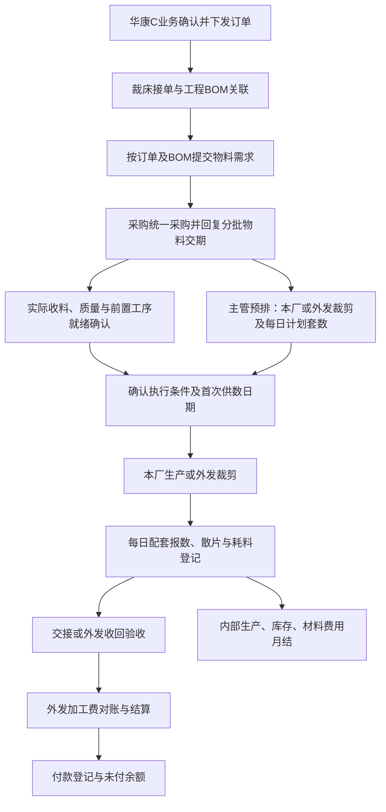

# 华康C裁床部生产管理模块方案

> 版本：V2.1 分阶段实施稿<br>
> 日期：2026-10-16<br>
> 定位：业务需求、界面规划与分阶段开发依据<br>
> 状态：P1a、P1b、P1c、P2a 及 P2b 首批已实现；根目录本地开发库已显式补齐迁移并启用，现有 admin 接口及页面验收通过。员工账号后续指定，真实岗位授权、真实订单及线上生产环境验收未完成；批量填数及返工退回等后续批次、P3a 领料申请与布料仓实发／签收已实现，P3b 首批耗用、损耗、盘余核对与原批次计价及第二批只读成本核对汇总已实现，0156 本地迁移及现有 admin 空台账页面验证已完成，真实业务验收待开展；第三批主管确认完工耗用归属、在制材料归集及单套正常材料成本已实现；P4a 月结前核对已接入真实台账；P4b 首批内部月结编制、月末归集、会计复核锁月及受控反结已实现，0163 本地显式迁移已完成，现有 admin 验收模式已启用，真实岗位另行授权；P4c 首批外发含税报价、验收对账、会计独立确认应付和受控反结已实现，启用与验收见专项清单；P4d 首批实际付款登记、会计双人复核与全额核销已实现；P4e 首批月结／外发结算冻结 Excel 与当前付款余额导出已实现，启用与验收见专项清单；预付退款、公共耗料／损耗分摊和专门期初录入继续推进。代码默认开关仍关闭。

## 1. 已确认的业务范围

以下内容来自用户明确要求，属于本方案的确定边界。

| 项目 | 已确认要求 |
| --- | --- |
| 模块入口 | 华康C → 生产部 → 裁床部 |
| 订单来源 | 华康C业务订单中心接单并下发 |
| 上游流程 | 收到订单后，由工程提供BOM，提交采购需求；采购统一订布料和辅料并回复物料交期 |
| 排期责任 | 裁床主管根据物料交期安排每日计划完成数量，系统生成对应完成期 |
| 默认准备周期 | 默认建议3个工作日，可按任务调整（含0天）；首次编制发布无需原因、调整已发布计划须填写原因；大于0时就绪当天不计；预计交期用于提前预排，实际领料用于核定调整；未配日历默认周一至周六工作 |
| 部分到料排期 | 不要求所有辅料到齐；可设定当前生产阶段所需物料，部分到齐即可安排对应任务／批次，剩余辅料持续跟进 |
| 数量口径 | 交数按配套数量计算，不以所有裁片数量简单相加 |
| 执行方式 | 本厂裁剪、外发裁剪；本模块的外发仅包括裁剪 |
| 实际填数 | 裁床文员每日填回实际完成数量 |
| 六个业务区 | 排期、填数、物料库存、月结、基础资料、实际生产物料费用 |
| 月结范围 | 同时包含内部生产／库存／材料费用月结，以及外发裁剪厂加工费对账、应付金额和结算单 |
| 界面及设计思路 | 参照现有喷油部模块，结合裁床业务调整 |

本文其余内容为推荐设计。文中标明“建议”或列入第17节的规则，不应在开发时当作已经批准的业务规则。正式计价、结算及日历参数应由责任人确认后生效。

## 2. 当前系统基础与接入缺口

### 2.1 可以沿用的能力

- 订单中心已经具有订单明细、不可覆盖的历史版本、下发快照、签收和变更通知。
- 现有平台提供登录、厂区与部门权限、工作区组件、表格、弹窗和导出基础。
- 喷油重建模块提供独立工作区、订单追踪、未保存内容保护、操作结果核对、确认后更正、批次物料与期间冻结等参考实现。

### 2.2 需要补齐的部分

1. 当前主线已提供华康C客户映射（INDEX、JAZAWARES／JAZWARES、MAXX、STROTTMAN、JP）。裁床沿用华康C自己的业务订单台账与下发快照；不得整体搬回华康D客户或改写其历史订单。
2. P1c 已增加华康C独立裁床接收方、权限及版本签收；与PMC、仓库和注塑可同时下发，裁床实际执行仍需独立计划和物料条件。
3. 生产BOM、布料采购及布料仓库尚不能视为已经完整接入。第一阶段必须补齐结构化资料登记和交期回复，或接入经核验的上游接口。
4. 工程页的BOM展示卡、生产计划展示卡不能作为真实业务接口已实现的依据；报价BOM也不能未经工程确认直接当作生产BOM。
5. 喷油模块当前默认关闭，生产页面仍保留占位入口。本方案依据其代码、界面合同和设计文档，不宣称已完成在线喷油界面操作或现场验收。

裁床模块应使用独立业务记录。喷油、纸箱、注塑的现有数据和计算规则保持各自边界；只在评估后复用通用组件及控制机制。

## 3. 界面：六个业务区，加生产看板与操作日志

### 3.1 参考关系与边界

采用本项目布料仓的顶部导航、页内分类、摘要、筛选和表格组织方式，复用项目通用界面组件。保留裁床独立权限、订单版本、配套、签收、实际耗用与锁月规则；不照搬喷油工资、工序产值或委托方收款。

### 3.2 主界面结构

顶栏为“裁床部／返回生产部／华康 C／使用说明／账号”。厂区标识不是切厂控件。下方横向导航依次为：

| 工作区 | 页内结构与主操作 |
| --- | --- |
| 生产看板（默认入口） | 当日任务、异常任务、历史与计划外实绩；按日期、订单和执行方核对，携带原任务与业务日期进入填数 |
| 生产排期 | 总订单、已排期、未排期摘要；订单台账及现有 BOM、需求、预排和实际核定；领料只提供跳转 |
| 每日填数 | 每日任务、日报记录、裁片配套、外发收回与验收、交接与抽查；保留原填报和更正流程 |
| 物料库存 | 库存台账、订单领用汇总、收发记录、领料申请、耗用与余料、采购交期 |
| 月结 | 月结总览、内部月结、外发对账与结算、付款与核销、冻结报表、历史期初 |
| 基础资料 | 产品与配套 BOM、物料与单位、本厂与外发资源、工作日历；日历仍保存到执行方版本 |
| 物料费用 | 订单费用、耗用与原批次、完工与在制归属、待计价与核对、成本变更历史 |
| 操作日志 | 按授权来源、单据、操作人和依据查询；保留原事件、版本、业务日期及关联记录 |

**统计与追溯口径：**

- 订单数量摘要按有效下发 `line_id` 去重（笔），不等于订单头或套数；总数＝已排期＋未排期。部分排期算已排期；仅草稿、发布已失效算未排期；有效发布后的新草稿不取消既有已排期状态。取消单不计卡片，历史台账仍保留。摘要在基础筛选后、分页前计算，排期状态筛选只改变下方列表。
- 每日看板按订单与任务去重，草稿不计已填报，明确填零仍计已报；合格完成与交接分列。无实际核定依据只提示待核定，不推测缺料；外发报称不计完成。
- 库存余额＝有效签收－仓库生效退仓－正常耗用－损耗；未签收单列、不同单位不相加，不另建库存账。订单领用汇总按订单、冻结任务／执行方／BOM、物料版本及单位归并，仍回到原实发查看。
- 月结状态按当前有效单据计算，冻结历史分别标识当前与失效；付款余额导出使用现有全量有效余额口径，不伪造单笔历史冻结余额。
- 日志聚合已有落账证据，服务端按真实操作时点稳定分页；翻页发现追加记录或权限范围变化要求刷新。成本、结算和付款分别校验权限。外发价格确认作为原事件展开凭据，不冒充月度结算单。未记录的历史岗位和失败尝试不补造。
- 使用说明通过弹窗展示岗位流程、数量口径和权限边界。页内切换保留编辑器及未保存输入，跨页仍执行原离开与未知结果保护。

实施与验证范围见 [界面改版验收记录](../cutting/cutting-workspace-redesign-acceptance.md)。原型中的示例数字不进入正式页面。

### 3.3 统一交互原则

- 使用项目深青绿色主色、浅色底面、细边框和紧凑表格，遵循 `DESIGN.md`。
- 订单总台账固定生产单号、客户／货号等识别列，其他列按订单、物料、计划、实际和月份分组；宽表只在自身容器内滚动。
- 月份按所选期间动态展开，不把7月、8月等写死为固定字段；未知值显示“待确认”，缺报与明确填零分别显示。
- 看板和每日任务按所选业务日期查询，日报详情保留该日期作为统计截至日期；月结、费用页面另有明确的月份选择，避免混淆“当天”和“整月”。
- 当前订单详情在页内展开；从订单进入其他页时保持订单筛选及关联记录定位。订单侧栏与窄屏抽屉作为后续交互优化，不列为本轮已完成项。
- 小于1024px优先列表和单任务填报；窄屏保留日期、任务识别及主要按钮，复杂排期以表单提供等价操作。
- 保存期间阻止重复提交；网络超时保留填写并核对上次操作结果，不能再次生成一笔新业务。
- 切换页面、厂区或账号时处理未保存内容；失效的旧请求不能覆盖新上下文。模块只接受明确的华康C厂区，不回退其他厂。
- 配套、超产、缺料、待计价等状态同时使用文字和颜色；不能仅靠红绿底色表达。
- 首次上线无数据时显示真实空状态和下一步动作，不能沿用喷油演示数字。

## 4. 业务流程与单据链



采购预计交期支持预排，不等于物料已经可用。订单下发也不直接生成实际库存、耗料或完成数量。

建议的关联层次为：业务订单明细 → 裁床生产任务 → 本厂／外发执行任务 → 日计划、日报、物料流水、交接／验收、费用及结算。

一张订单可以有多个部件、颜色和执行任务；一张采购单可以供应多个生产任务。所有拆分和合并均保留原订单及数量分配关系。

## 5. 排期业务区

### 5.1 页面分区

- **订单总台账**：参照截图，查看订单、物料、计划、实绩、差额和月度汇总。
- **待排需求池**：显示待接单、待BOM、待采购回复和可排任务，支持筛选及批量关联。
- **日计划表**：按任务／执行方展示每天计划套数，支持日期窗口、批量填数、复制计划和局部调整。
- **计划版本**：查看首次发布计划、当前有效计划、调整内容与原因、操作者及版本影响。

主操作为“接收订单”“拆分任务”“编制日计划”“预览调整”“发布计划”。确认或审批层级见第17节；不得自行增加不必要的逐日审批。

### 5.2 工作日及完成期

- 准备周期默认建议3个工作日，并非强制最低限制。主管可按本厂／外发任务设置0～365个工作日；首次编制、保存及发布计划无需填写原因；已有发布计划后，修改准备周期、日计划或其他任务设置须填写调整原因并保存新草稿。发布修订版时带入已保存的调整原因，可核对修改；旧草稿未保存调整原因时须补填。系统保留原因、操作者、新旧版本及首次基准。由生产日历定义休息日、节假日、调休和加班工作日。
- 已确认不要求所有辅料到齐，可按任务／批次设定当前生产阶段所需物料，部分到齐即可安排生产排期。未列为当前阶段必需的辅料不统一阻止排期，但须继续显示缺料数量、预计到期和后续影响。
- 已确认以该批任务所配置的开工必需物料及贴合／捆条等前置工序就绪为任务准备周期的起算条件；不能以全部辅料最晚到期日作为统一起算日。本厂／外发分别配置每周工作日及休息、调休、加班日期。
- 准备周期大于0时起算当天不计，按所设天数顺延工作日；0天允许就绪当天供数，当天休息则顺延到下一工作日。默认3天示例：周一就绪、周二至周四均为工作日，则周四开始供数；调整为1天则周二、0天则周一开始供数。收到订单、工程确认BOM及需求、采购回复当前必需料交期后即可提前编制每日计划，不必等待实际领料。预排采用预计日期；实际领料后按实际领料及前置工序实际就绪日核定，预计和实际供数日分别展示。未配资源日历两阶段均默认周一至周六工作、周日休息；涉及节假日／调休须配置日历。实际日期须有凭据且不得晚于北京时间当天；仓库接口未接通前保留人工核对依据，不自动生成库存流水。
- 采购回复用于预计首次供数日；实际到料确认后形成执行条件。计划开裁日、首次供数日、计划完成日分别记录。
- 系统按主管填入的有效日计划累计达到任务目标数量的日期计算计划完成期；未排足数量时显示“计划未排完”。
- 建议首次基准计划保留不可覆盖版本，后续调整形成新版本。物料延期提示受影响任务，不静默移动已发布计划或历史日报。
- 允许部分到料形成可生产批次；需要核对当前阶段每种已配置必需物料的实际可用量，并扣除其他任务已占用部分。只满足部分数量时，按可支持数量分批执行；预计后续来料支持预排，不冒充实际库存。
- 界面建议在物料清单增加“当前阶段是否必需”“适用部件／工序”“可支持生产数量”“未到料影响”及责任人字段，由有权限人员配置并保留调整记录。无需逐张订单重复勾选全部物料，可从工程确认模板带入再核对。
- “可开始裁剪”和“可报完整套数”分别判断：部分物料到齐可先安排相关部件裁剪，尚不能形成完整配套时保留散片／在制数量，不能提前计为合格完成套数。
- 不同产品套数不能直接等同于工作负荷。第一版由主管编制每日生产计划；同产品／已确认换算的资源可进行容量提示，标准工时未确认时不宣称自动最优排产。

### 5.3 排期示例

某任务目标6,350套，每个生产日安排1,500套，最后一天安排350套，需5个有效生产日。日期按实际工作日历落位，不能把中间休息日算作有效产出日。

本厂6,000套、外发4,000套组成同一订单10,000套时，应分别形成执行任务和日计划。允许暂时未分配完，明确显示待分配量；累计分配不得无依据超出有效需求。

## 6. 填数、配套及交接

### 6.1 配套口径

工程BOM应定义产品／款式、颜色、规格、部件及每套所需裁片数量。不同版本和不兼容规格不得混配。

对同一可配套范围，设部件i每套需用 `rᵢ` 片，尚未用于配套的合格可用量为 `qᵢ`：

`本次最多可新增配套数 = min(floor(qᵢ / rᵢ))`

例如每套需要前片1片、后片1片、袖片2片；分别有1,000、950、1,800片合格可用裁片，可组成900套，剩余裁片继续保留。缺少一种必需裁片不能按其他部件平均完成量报套数。

### 6.2 推荐两种填报方式

| 方式 | 使用条件 | 控制 |
| --- | --- | --- |
| 直接报合格配套数 | 现场已经完成核套，适合文员日常快速录入 | 记录核套人／依据与任务版本；声明为完整套，不伪造每种裁片实际产量 |
| 按裁片核套 | 现场有可靠裁片明细，需要管理散片及欠片 | 先登记合格裁片，再生成配套记录并扣减可配套散片，不重复生成生产完成量 |

已确认每个任务固定一种记录主口径：直接报完整套数或按裁片核套。直接配套报数和裁片自动核套不能同时增加同一批产量。跨批、跨执行方合并配套需要可追溯的移交和数量分配，不能仅凭相同货号自动合并。

### 6.3 每日报数

文员按生产日期选择任务，登记当日新增合格配套数、未配套裁片、待判／不良／报废及异常原因。已确认文员提交即生效，主管抽查，不设置主管逐日报批。已实现保存草稿、提交、更正、作废及抽查；批量粘贴预览留待后续批次。

日报保留业务日期、录入时间、录入人、执行方、订单／BOM版本及更正关联。漏报与填零不同；超产允许登记真实事实，但应提示、留原因并核实是否纳入任务及结算额度。

日报确认不自动推定领料、耗料、仓库收回、下道交接或客户出货。上述事实分别登记，并由共同任务关联。

### 6.4 本厂与外发的数量状态

- 本厂：实际合格配套完成 → 待交接 → 已交给下道工序。
- 外发：外厂报称完成 → 发回在途 → 实际收回 → 验收合格／待判／不合格 → 交接。
- 外厂报称完成用于预计进度，不直接作为已验收数量或应付依据。
- 外发只含裁剪；后续车缝、手工和包装不重复记为裁床产量。
- 返工关联原任务，不重复计正常订单完成量；修正、退回和重新验收保留原记录。
- 本模块的裁片／配套交接不自动生成现有半成品仓入库，接收方和仓库接口另行确认。

### 6.5 统计口径

已确认将原“累计交货欠产”改名为“累计计划差额”，并单独列出“未完成套数”；两项不得混用。未完成套数的计算已确认采用“订单总数－已完成数”，两者均按同一订单的配套套数统计。P2b 首批已实现按单汇总；订单总套数采用工程确认的订单换算口径，未核定时不以原订单件数或执行任务目标代替。

| 指标 | 口径（已确认项注明，其余为建议） |
| --- | --- |
| 当日计划套数 | 当前有效计划在所选业务日的数量 |
| 累计计划套数 | 截至所选日期的有效日计划合计，详情可对比首次基准计划 |
| 累计合格完成套数 | 确认的合格完成记录净额；外厂自报及验收采用独立列，不混计 |
| 累计计划差额 | 已确认：累计已交接套数－累计计划套数，负数表示落后 |
| 未完成套数 | 已确认：`订单总数－已完成数`，按同一订单的配套套数计算，直接保留相减结果 |
| 完成率 | 累计合格完成÷任务有效目标；目标为零或未知时不计算，真实超产不截成100% |
| 已完成未交接 | 可交接合格数量扣除有效交接净额 |
| 月计划／月实际 | 按业务日期汇总该月明细，不能取页面当前加载的部分行求和 |

总台账同时保留“完成”和“交接”指标，已确认截图的“实际交数”采用已交接套数，合格完成套数另列；累计计划差额使用交接实际减计划。

示例：订单总数153,000套、截至当日计划115,000套、已完成107,500套；若已交接同为107,500套，则计划差额为−7,500套；未完成套数为153,000－107,500＝45,500套，完成率约70.3%。

## 7. 截图字段对应表

截图仅用于字段与布局识别，没有原始工作簿，不据此确认隐藏列、公式、全部行数据或导入映射。截图中出现的日期、颜色和示例值不作为系统默认数据。

| 原字段 | 系统字段与来源 |
| --- | --- |
| 放产日期 | 业务放产日期；与下发时间、实际开裁日期分开 |
| 洋行名 | 界面统一显示为“客户”，关联客户资料并保留订单快照；不设置“内／外”分类 |
| 负责仓管 | 人员资料关联及负责人历史快照 |
| 生产单号 | 裁床生产单标识，关联来源订单明细；编号规则待确认 |
| 合同号 | 保存原合同／MA等标识，各编号关系需业务确认 |
| 货号 | 产品识别，保留前导零、短横线及原字符串 |
| 货名 | 订单列表与详情沿用业务下发快照的中文货名，缺失时显示英文货名，两者均缺失显示“未填写”；历史记录显示对应历史快照，不从当前产品资料补写 |
| 款式分类 | 普通款／稀有款沿用业务订单分类，不由裁床单独维护；当前下发契约尚无独立分类字段，先显示“未分类”，后续须接通业务分类后才能展示具体类别，不按货名、备注或货号推测 |
| 订单数量 | 原订单数量与单位；裁床目标套数单独记录并校验换算 |
| 物料期 | 显示关键物料预计就绪日期，展开查看采购批次及实际到料 |
| 贴合／捆条 | 前置工序要求、预计日期、实际状态；“/”“齐”等原值不能直接猜成日期 |
| 裁剪厂商 | 本厂车间或外发加工厂，关联执行任务 |
| 裁床计划 | 从每日计划生成文字摘要，明细是计算依据 |
| 当日计划交数／实际交数 | 对应所选日期的计划及明确业务口径的实际净额 |
| 累计计划总数／交货总数 | 截至所选日期的累计量，计划、完成和交接分列 |
| 累计交货欠产 | 已确认改名“累计计划差额”，单独列出“未完成套数” |
| 累计交货进度 | 根据明确分子和任务目标计算，展示对应指标名称 |
| 月交货总数／月计划总数 | 日期明细按月动态汇总，可展开，不按月份加数据库固定列 |

新增必要字段包括：来源订单版本、BOM版本、任务目标套数、执行方式、实际物料就绪日期、首次供数日、计划完成期、实际完成日期、合格完成／已交接量、物料费用状态及月结状态。

## 8. 物料库存与采购协同

### 8.1 唯一库存来源

布料仓库、裁床现场和外发厂应围绕同一套物料批次、存放位置及库存流水展示。若仓库模块尚未实施，先确定权威流水所属模块及接口，不能让两个模块各录一次收货。

| 位置 | 主要记录 |
| --- | --- |
| 布料／辅料仓 | 采购实收、质量状态、预留、发料、退回及盘点 |
| 本厂裁床现场 | 领入、可用余料、实际耗用、损耗、退回及调拨 |
| 外发加工厂 | 发出、签收／在途、在外结存、耗用、余料退回及差异 |

发料是位置及保管责任变化，不立即等于生产耗用。外发料在途与厂商确认收到分别记录，合并查看时不能重复算两份库存。

### 8.2 采购需求及到料

- 工程发布生产BOM，并由工程部正式提交物料需求（已确认）。首批由工程明确目标套数、数量依据并逐行核定需求量；损耗、库存抵扣及审批规则未获确认，不自动推算净采购量。采购交期先沿用 PMC／仓库部门、单独授予权限（已确认）。
- 采购可统一采购、分批回复预计日期与数量，保留采购明细到多个生产任务的分配关系。
- 采购承诺、供应商发货、仓库实收、质量可用分别记录；延期通知关联受影响计划。
- 物料用途区分当前裁剪阶段必需料与后续工序用料，支持配置部分到料即可排期；非当前必需辅料继续跟进到期，不一律阻止当前排期。哪些物料属于当前阶段必需、如何触发可调整准备周期的起算及后续工序约束，按任务适用规则明确。
- 上游未接通时允许带来源说明的结构化登记／模板导入；后续正式来源接入采用核对关联，不能重复入库或重复生成需求。
- 裁床不承担采购付款流程。布料供应商采购应付并未在本轮明确纳入裁床月结，需独立确认系统边界。

### 8.3 库存控制

- 物料身份至少包含编码、名称、规格、颜色、基本单位；批次、色缸、幅宽、克重等按物料类型补充。
- 预留影响可用量，不改变实物在库；共享批次不能重复分配给多个任务。
- 整卷、散料、可复用余料和报废分开；不同规格或质量状态不能直接合并。
- 单位换算需明确来源：公斤转米依赖对应物料及条件，不使用全局固定比例。
- 推荐无可用库存时阻止正常出库；特殊短账处理规则、审批及后补流程须先确认，不默认允许负库存。
- 更正通过关联原流水的冲销或调整完成；已被后续使用的物料不能无约束撤销原收货。
- 盘点以截止时点的账面与实际数比较，登记差异原因；期间锁定、并发收发和历史日期的影响必须核对。

## 9. 实际生产物料费用

### 9.1 页面与口径

提供“订单费用”“耗用明细”“标准与实际对比”“在制与待计价”四个页签，可按生产单、执行方、月份、物料及币种筛选。每笔金额可展开到耗料、批次价格和来源凭据。

| 费用 | 依据 |
| --- | --- |
| BOM标准材料费用 | 同一目标／比较产量的标准用量×已确认参考价格 |
| 实际材料费用 | 实际耗用数量×适用库存成本，包含明确归属的调整 |
| 未配套／在制材料费用 | 尚未归属于已完成配套的实际投入，按确认规则结转 |
| 外发加工费 | 外发验收与冻结单价形成，单独列示，不混入材料费用 |

不能将订单总量×BOM用量直接标成实际耗料，也不能用当前采购价重算已经结算的历史耗料。

### 9.2 耗用登记与对账

可直接登记任务实际耗用，并通过盘余核对：

`期初现场结存＋本期领入／调入－退回／调出－期末现场结存＝本期耗用及损耗`

该平衡式用于核对或经确认的盘余计耗方式，不与已经登记的耗用重复相加。正常耗用、报废、非生产损失和盘点差异分别分类；未分配到订单的公共耗料进入待分配池。

### 9.3 成本规则

- 已确认按原实发批次实际成本计价，缺价显示待计价；PMC／仓库采购岗位单独授权确认实际单价、币种与成本凭据，暂不自动分摊税费、运费。采购导入单价不自动成为正式库存成本。
- 退料追溯原领用和成本来源；退回物料与供应商扣款是不同事实。
- 未知价格保留为空并显示待计价；明确的零价需要证据，不能用零掩盖缺失。
- 共用耗料的分摊规则、损耗承担、余料价值、税费和运费计入方式均需版本化确认。
- 不同款式的套数不能不经规则就作为统一费用分摊权重。
- 本批单套正常材料成本＝主管确认归属于对应合格完工的正常材料费用÷对应合格完成套数；外发取验收合格数。套数为零、缺价、物料未归齐或公共耗料待分配时显示待核对。损耗费用单列，暂不摊入；各币种分别显示单套值，保留六位小数，HALF_UP。
- 金额计算推荐后端Decimal，中间保持精度、单据金额按确认规则到分；保存币种和舍入规则。不同币种不直接相加。
- 费用补价形成调整证据，不能覆盖已冻结月结和历史导出；锁期后的补价采用批准的调整或反结流程。
- 材料费用不是订单总利润；人工、设备等成本未纳入时不展示“完整利润”。

## 10. 月结：内部核算与外发结算

### 10.1 内部月结

推荐页签：生产核对、物料收发存、材料费用与在制、锁月记录。

| 核对范围 | 主要内容 |
| --- | --- |
| 生产 | 本月计划／合格配套／交接数量、未填日报、超产、未完成订单、散片及返工 |
| 库存 | 期初、实收、位置转移、实际耗用、退料、损耗、盘点差异、期末及外发在外料 |
| 费用 | 已知材料费用、未计价、待分配、在制结转及订单成本差异 |
| 完整性 | 未确认单据、未解决更正、缺价格／规则、账实不符及结算争议 |

流程建议：生成核对草稿 → 跳转处理异常 → 责任人复核 → 冻结本期快照 → 锁定月份 → 导出。

跨月订单继续沿用原单，本月只归集本期事实。生产、库存和费用完成度分别展示；生产数量核对完成不代表财务已结清。物料缺价等未解决事项必须影响相关费用结清状态。

### 10.2 外发加工厂对账与应付

推荐页签：待结明细、对账单、结算单、付款登记、调整与历史。

- 外发任务保存加工厂、裁剪范围、计价单位、单价版本、币种及价格依据。生产按套统计；按片报价时另存计费数量和确认的转换关系。
- 首批已确认按截至所选月份的验收合格套数计费，允许部分及跨月续结；外厂自报、收回未验收及超出冻结任务额度的数量不自动计费。验收沿用独立 acceptance_write 权限，真实验收员工另行指定。
- 支持部分验收、部分结算和跨月继续结算；同一验收数量不能被两张单重复占用。
- 可结数量来自验收证据扣除已有有效结算分配及退回限制；未结退回释放或减少额度，已结退回形成关联原单的贷项／调整，不能既扣数量又扣款两次。
- 外发超产能否付费须单独确认；实际数量保留不等于超额费用自动获批。
- 我方材料成本与加工费分别归集，不能把我方供料再次算进外发加工费。
- 补料、返工、报废、扣款、补款及其他费用逐项记录来源、责任和确认结果。
- 首批采用单独授权裁床主管确认的每任务含税结算单价、币种及报价凭据，可形成正式含税应付；不自动拆税、汇兑或另加运费、扣补款。CNY／HKD／USD 分别核算，零价也须凭据。已确认结算保留原价，新报价不追改旧单。

对账流程建议：生成草稿 → 核对验收／价格／调整 → 记录与加工厂的核对结果及凭证 → 内部确认 → 冻结结算单 → 登记付款与核销。

系统不自动对外发送信息。加工厂在线登录及消息发送属于后续单独确认范围。

### 10.3 付款及期间保护

- 结算确认与付款分开：已确认有效应付扣除有效付款核销，形成未付余额；退款、冲销和贷项分别关联处理。
- 一笔付款可分配多张结算单，多次付款可核销同一张单；币种、额度及重复登记需核对。
- 仅登记实际付款凭证和核销，不自动操作银行；预付款或超付需要独立规则，不默认为负未付余额。
- 内部月结与外发月结状态分别保存，互相展示未完成影响；外发争议金额未确认时，完整任务成本不能标为已结清。
- 锁月后不得直接编辑当期正式单据。更正采用开放期调整或有权限的反结，并保留原版本、原因、操作者和时间。
- 结算修订不删除已有付款证据；已有核销、后续期间或关联入账时，先检查影响再允许反结。
- 精确结账顺序、审批分工、未开票金额与争议费用处理，由财务确认后实施。

## 11. 基础资料

| 类别 | 建议内容 |
| --- | --- |
| 客户与订单映射 | 华康C客户清单、来源字段、订单编号及生产单关联；同名客户不等于同一来源 |
| 产品与配套 | 货号、款式、颜色、规格、部件、每套裁片数及有效BOM版本 |
| 物料 | 布料／辅料编码、规格、颜色、基本单位、专属换算和适用批次属性 |
| 单位与损耗 | 订单单位转套、物料单位换算、标准损耗规则及来源 |
| 工程资料 | BOM附件、结构化明细、用量、前置工序和发布／变更记录 |
| 执行资源 | 本厂车间、裁床资源、负责人、外发裁剪厂及有效状态 |
| 位置与保管 | 仓库、仓位、本厂现场、外发在途／厂商保管位置 |
| 工作日历 | 本厂与外发分别配置工作周和例外日；无日历按领料就绪及周一至周六默认工作周推算 |
| 价格与费用 | 外发价格版本、计价单位、币种、成本及分摊规则、月结规则 |

优先引用现有权威客户、人员等主资料。历史单据保留当时的名称、规格和价格快照；停用资料不删除历史证据。临时资料须标记待完善，不能用默认值伪造完整资料。

## 12. 角色与权限建议

| 角色 | 主要权限 | 边界 |
| --- | --- | --- |
| 华康C业务 | 接单、确认／下发、订单变更、进度查询 | 不能直接修改裁床实绩和库存 |
| 工程 | 生产BOM录入、发布、工艺资料和版本变更 | 不直接代替采购承诺到料 |
| 采购 | 接收需求、采购关联、物料交期回复及修订 | 不代替仓库登记实际收货 |
| 仓管 | 实收、质量状态衔接、发退料、盘点 | 不自行改外发单价或生产计划 |
| 裁床主管 | 接单、拆任务、执行方分配、计划发布调整、异常处理 | 月结、单价及付款权限另行授予 |
| 裁床文员 | 日报、散片、外发回报、交接登记 | 不默认拥有补价、锁月、反结和价格查看权限 |
| 财务／结算员 | 成本核对、外发应付确认、月结与受控反结；付款后续 | 已确认主管编制、会计独立复核；付款由会计登记、另一会计复核；开票及争议费用规则待确认 |
| 管理人员 | 按范围查看汇总、异常和审计 | 跨厂权限必须明确授予 |

所有后台操作校验厂区、部门、动作及当前授权；不能只隐藏按钮。数量查看与成本、加工价格、付款查看分开。外发厂不因被选为执行方而自动获得内部账号或订单访问权。

## 13. 订单、BOM及其他异常处理

- **加单／减单**：接收新订单版本，比较已分配、已完成、已交接、已发料及已结算事实。减单低于已执行量进入异常处理，不能直接扣掉历史产量。
- **取消订单**：停止后续安排，保留已生产、在外料、退料、费用及结算处置任务，不删除整单证据。
- **BOM变更**：发布新版本并明确影响范围；已确认领耗料、日报及结算继续引用原版本，剩余任务经确认后切换。
- **采购延期／短料**：标出受影响任务和预计完成期，由主管重排；实际到料不可被采购预计日期覆盖。
- **超产／欠产／缺片**：真实数量保留，原因与处理分开，超产不直接扩大采购、交接或外发付费额度。
- **报数更正**：确认前改草稿，确认后关联原记录更正；检查其对配套、交接、库存和结算的影响。
- **重复点击／网络重试**：同一次业务操作只记账一次；保存结果未知时先查询原操作结果。
- **历史导入**：先预览映射和差异，再确认；只有累计值时作为有截止日期的期初，不能编造每天的实际数量。期初模式与完整历史流水重放不能重复采用。

## 14. 数据与接口规划（建议，不是已存在实现）

模块入口为 `/modules/production/cutting`，只接受明确的 `huakang-c`。基础资料页面接入 `/api/cutting-operations`，独立权限为 `cutting_ops:read`、`master_write`、`bom_write`、`bom_publish`。后端逐次校验厂区、部门和动作，显式禁止有效；工程负责 BOM 写入与发布，生产负责物料和执行资源维护，读取可授予生产、工程或现有 PMC／仓库采购岗位。固定岗位不自动获得这些新权限。P1c 第一批已接入排期区的接单／工程需求和物料区的采购交期；P2b 首批每日填数已接入独立实绩接口；P3b 首批耗用与批次成本使用独立只追加事件，P4a 月结前核对已接入只读月度接口，P4b 已提供内部锁月和反结接口，P4c 提供独立外发报价、对账、应付确认及反结接口，须完成0165迁移和单独授权后启用。

核心数据组：

1. 订单接收及版本关联、裁床任务、执行分配。
2. 生产BOM版本、部件配套规则、物料需求及采购来源关联。
3. 采购交期回复、实际到料及可用分配。
4. 生产日历、计划版本、每日计划与调整。
5. 日报、配套／裁片记录、质量状态及更正。
6. 库存批次、位置、预留、收发退调耗及盘点流水。
7. 外发任务、回收／验收、交接及退回。
8. 耗料成本、待分配费用、在制分配及成本调整。
9. 外发价格版本、对账／结算／付款与逐行核销。
10. 期间状态、冻结快照、附件、导入来源、操作回执和审计。

共享物料库存由统一事实源提供，最终物理表归属取决于布料仓库接入设计，不能按页面重复建账。上游工程及采购同样保留唯一权威资料，裁床保存关联与必要快照。

写入推荐采用版本检查、幂等键及事务保护。业务记录、数量／金额流水、审计和操作回执在同一事务内确认；库存、配套和结算额度须防止并发超用。服务端计算统计及费用，不能信任前端上传的累计总数。

新增数据库结构采用明确迁移，禁止启动时顺便重置业务数据；开发使用隔离环境和功能开关，验证后再安排业务环境迁移。当前文档不授权运行迁移、导入历史数据或发布上线。

## 15. 输出报表

| 报表 | 来源及用途 |
| --- | --- |
| 裁床生产总台账 | 接近截图，包含订单、物料期、计划、实际、差额及月度汇总 |
| 每日计划／实际报表 | 同一日期与口径对比，识别未填、欠产、超产及异常 |
| 配套及欠片表 | 配套BOM、可用裁片、已配套及未配套缺口 |
| 物料收发存表 | 按物料、批次、位置、期间核对期初与期末 |
| 外发在外物料表 | 已发、厂商签收、耗用、退回及结存 |
| 订单材料费用表 | 标准、实际、损耗、在制、缺价和待分配 |
| 内部月结表 | 生产、库存和材料费用分项核对及冻结状态 |
| 外发对账／结算单 | 加工厂、验收明细、计费数量、冻结价、调整及应付 |
| 付款及未付余额表 | 结算与付款核销关系，不等于银行自动付款 |

导出保留单位、币种、统计截止日期、口径、制表人及版本。涉及费用的导出重新校验金额查看权限；正式月结导出使用冻结快照。原始截图不是可逐单元格复刻的Excel模板，精确打印版式需取得原工作簿后确认。

## 16. 分阶段实施与验收

### 16.1 开发顺序

| 阶段 | 交付 | 验收重点 |
| --- | --- | --- |
| P0 业务与来源核对 | 确认第17节规则、华康C客户来源、真实订单及BOM／采购／结算样例 | 关键字段都有责任部门和权威来源 |
| P1 工作区与基础 | 六区导航、厂区权限、资料版本、订单下发和接收、最小BOM与采购交期链 | 真实空状态、无重复下发、华康C数据隔离 |
| P2 排期与填数 | 本厂／外发拆分、工作日计划、配套报数、交接与更正 | 计划、套数及不同实物阶段不重复统计 |
| P3 库存及实际费用 | 收发存、外发在外料、耗用、余料、计价和在制归集 | 库存数量与费用均可追溯，未知不补零 |
| P4 双范围月结 | 内部核对、外发验收结算、付款核销、锁月与调整、冻结导出 | 可部分结算、跨月延续、防重复和历史保护 |
| P5 业务试运行 | 历史期初预览、全流程回归、权限和并发、真实样例及浏览器验收 | 对账一致，正式迁移及启用单独安排 |

可以分批开发，但六个业务区及内部／外发月结均属于已确认的目标范围。不能以“只有排期和日报”宣称完整模块完成。

### 16.2 当前交付与后续顺序

本轮将 P1 拆为可独立验收的 P1a、P1b、P1c，不改变六区及双范围月结的完整目标。

| 批次 | 当前状态 | 交付与边界 |
| --- | --- | --- |
| P1a 入口与工作区 | 已实现 | 华康C生产部裁床卡片、独立工作区、六业务区加看板／日志的顶部导航及页内视图、字段预览、明确的待接入状态、返回生产部；支持直接链接及查询参数切厂防护 |
| P1b 基础与授权 | 已实现，本地 admin 已启用 | 独立权限、显式增量迁移、物料与本厂／外发资源版本、生产 BOM 草稿／发布、每套部件及必需物料配置、版本记录；默认关闭 |
| P1c 订单与交期 | 已实现，本地副本业务链已验证 | 业务可同时向裁床及其他部门下发，裁床签收、工程关联发布 BOM 并提交需求、采购分批交期与历史版本；正式采购单／库存未接入 |
| P2a 任务与预排 | 已实现，本地副本预排已验证 | 完整套数本厂／外发任务拆分、资源日历、可调整工作日准备周期与预计供数、每日人工计划、草稿／发布／基准版本及变更复核；不记录实际完成或库存 |
| P2b 每日填数与配套 | 首批已实现，本地 admin 已启用 | 草稿／提交生效／更正／抽查、直接报套与裁片核套、外发收回验收及交接、按日月汇总；批量粘贴、返工退回等继续分批 |
| P3a 领料申请与布料仓对接 | 已实现，验收边界见下文 | 按任务与 BOM 申请、布料仓分批实发、裁床分批签收、关闭未发余量；不自动记耗用或核定已发布计划 |
| P3b 耗用与原批次计价 | 首批、第二批成本核对汇总及第三批人工归集核算已实现；真实业务验收待开展 | 按原实发登记正常耗用、损耗及盘余；采购确认批次成本，主管单独授权确认累计完工归属，余量列在制；按合格完成套数分币种核算单套正常材料成本，缺价或归集未齐时待核对；公共耗料／损耗分摊、纯盘点差异和调拨等继续分批 |
| P4a 月结前核对 | 已实现只读预览 | 自然月、最新有效事实重算；生产与外发数量、原实发收发耗存、当前批次价试算、待办和关联历史；不冻结、不锁月、不生成应付 |
| P4b 内部月结与锁月 | 首批已实现，启用与验收见专项清单 | 裁床整月编制、月末完工／在制归属、期初承接、主管提交与会计复核锁月、历史冻结及受控反结；缺价和未核清期初／归属阻止锁月 |
| P4c 外发加工费对账与结算 | 首批已实现，启用与验收见专项清单 | 验收套数、主管确认含税报价、部分对账、会计独立复核及冻结应付、占用防重、受控反结和追溯；付款核销由 P4d 独立办理 |
| P4d 付款登记与核销 | 首批实现，迁移与验收见专项清单 | 已实付凭证、同厂同币种全额分配、部分／多单核销、会计双人复核、冲销关联重登；不操作银行 |
| P4e 月结报表与冻结导出 | 首批已实现，验收见专项清单 | 内部锁月／外发确认版本的冻结 Excel，所选月付款与当前全期余额表；权限和生成期间依据复核，历史失效版本明确标注；不新增付款锁月 |
| P4 后续 | 待实施 | 预付款／退款、争议费用／扣补款与开票、公共耗料／损耗分摊等，按明确业务规则单独推进 |
| P5a 历史期初核对与切入准备 | 首批只读核对已实现 | 按切入月份月初回放此前有效事实，核对原实发余料、在制、生产及外发数量、历史结算／付款依据；账外资料显式映射、差异及缺项提示，不自动入账 |
| P5b 全流程与正式岗位验收 | 首批隔离验证与清单已完成，真实资料和账号待指定 | 合成样本真实登录贯通订单签收到冻结报表，最小岗位权限、双人复核、跨月付款与更正；正式业务签字尚未完成 |
| P5c 性能、打印与上线准备 | 隔离验证持续推进，正式验收未完成 | SQLite原数据副本迁移／恢复、并发和多订单基线通过；完整应用500单／100生产链／20财务链／10会话两档十分钟基线通过，新增20单交接／耗用与付款混合600秒通过；逐版本对账、月结编制批量取数和同余额／签收／退料／锁月有限混合流程已补验；导出排队、持续状态交错、目标长时容量、打印和真实岗位仍待验收；生产PostgreSQL需另验 |

P1a 批次仅交付导航和字段预览。基础资料由 P1b 提供实际 API 及版本化持久化；P1c 第一批在排期及物料区提供订单／工程需求／交期操作；代码默认关闭，本地已显式启用。P2b 首批填数区另有真实业务接口；P3b 首批成本区接入实际耗用与批次成本，迁移及独立权限未就绪时明确提示；P4a 提供实时月度核对，P4b 提供独立内部月结和锁月流程，P4c 增加外发对账及应付确认，P4d 在显式迁移后提供实际付款登记及核销。任何页面均不使用浏览器持久化业务记录或模拟数量。不能以六区页面开放声称 P1 全部完成。

前端实现位于 `src/features/cutting-operations/`，入口注册在 `src/data/enterpriseMock.ts`、`src/views/ModuleCenterView.vue` 和 `src/router/index.ts`。入口验收覆盖六区跳转、返回厂区、非华康C及重复厂区参数拒绝、同页修改厂区参数、页内视图重置和生产入口键盘操作；P1b 已增加后端厂区／部门授权和版本化资料测试，生产计算留待后续阶段。

P1a 文件清单：

- `src/features/cutting-operations/navigation.ts`：六区业务文案、字段及厂区常量。
- `src/features/cutting-operations/routes.ts`：独立路由、默认排期页与厂区入口检查。
- `src/features/cutting-operations/CuttingWorkspaceShell.vue`：顶栏、六区导航、账号及返回入口。
- `src/features/cutting-operations/CuttingWorkspacePage.vue`：页内视图、字段预览与待接入说明。
- `src/features/cutting-operations/workspace.css`：隔离样式、横向表格和窄屏布局。
- `src/features/cutting-operations/__tests__/navigation.spec.ts`：路由与工作区行为测试。
- `src/data/enterpriseMock.ts`、`src/views/ModuleCenterView.vue`、`src/router/index.ts`：华康C生产入口及主路由注册。
- `src/views/__tests__/moduleCenterFactoryScope.spec.ts`：华康C专属入口回归。
- 本文及 `PROJECT_MEMORY.md`：同步当前实现边界；原有 `.gitignore` 文档白名单变更保留。

P1a 原有入口及导航测试继续纳入回归；当前 P1b 的验证命令与边界见下文。

浏览器已验证本地华康C卡片可打开排期工作区，并核对月结页包含内部月结、外发对账、结算与应付、付款核销。六区切换和同页厂区改变由组件／路由测试覆盖；完整多尺寸、200%缩放、正式账号矩阵及真实业务数据验收尚未完成。

#### P1b 基础资料交付边界

- **物料**：布料／辅料、编码、规格、颜色、基本单位、权威物料编码／来源；维护的是裁床使用的资料引用，未替代全局物料主档或建立库存。暂不自动换算单位或计损耗。
- **执行资源**：本厂／外发执行方、联系人及来源；外发工序仅允许裁剪，不创建外发账号或授予访问权。
- **生产 BOM**：产品货号、款式、颜色、来源，部件编码及每套片数，固定物料版本、每套净用量、适用部件／阶段、当前裁剪是否必需、未到料影响。保存为草稿，由工程发布；修订产生新草稿，旧发布版本及其原物料名称继续可追溯。发布要求每个部件有用量依据、至少一种裁剪必需料，且引用物料当前未停用。非必需辅料允许保留；未实现可生产量或套数计算。
- **保存和追溯**：按预期版本检测冲突；工厂级事务锁串行化写入；同一操作编号相同请求返回原回执，异内容／异操作人拒绝。资料修订和操作回执在同一事务提交，记录操作者、时间及原因；停用保留历史。前端遇到保存结果未知会锁住表单并重试原操作。
- **数据结构**：迁移 `20261007_0131`（上游 `20260929_0130`）新增 `cutting_ops_masters`、`cutting_ops_revisions`、`cutting_ops_commands`。空合并迁移 `20261009_0149` 将裁床分支与主线 `20261009_0148` 汇合，保留双方原有迁移历史。启动 `create_all` 无论功能开关状态都排除这三表。缺少迁移时接口拒绝读写，不自动创建表、迁移历史数据或授予权限。
- **启用顺序**：默认 `CUTTING_OPS_ENABLED=false`。先备份并验证目标库的 Alembic 状态，在隔离库演练通过后按环境流程执行迁移，再为指定华康C部门人员明确授权，最后启用并重启。已有未登记迁移版本的本地库需先核对迁移状态，不能直接 `stamp head` 或盲目跑整个历史链。回退先关闭开关，保留已保存资料；该迁移不提供删除业务历史的自动降级。
- **未纳入本批**：工程附件上传／上游接口、订单及采购交期（另见 P1c 第一批）、工作日历及可调整准备周期计算（P2）、单位换算、库存、成本及月结。当前生产 BOM 为工程手动结构化登记，不能宣称上游订单或采购已经打通。
- **验证**：使用独立临时数据库进行接口、并发、权限及真实 Alembic 链迁移回归；前端验证表单、只读／未启用状态、版本冲突及原操作重试。本地开发库已显式补齐迁移；真实业务样例、员工岗位及 PostgreSQL 并发验收未完成。

P1b 主要文件：

- `src/features/cutting-operations/CuttingMasterPage.vue`、`api.ts`：基础资料实际表单、列表、查询、版本记录和请求处理；同目录路由、样式及测试同步。
- `backend/app/api/cutting_operations.py`、`models/cutting_ops.py`、`services/cutting_ops.py`、`services/cutting_schemas.py`：独立接口、模型、事务及数据校验。
- `backend/alembic/versions/20261007_0131_cutting_master.py`：显式增量迁移；主应用、数据库初始化、权限目录与部门策略作必要注册。
- `backend/tests/test_cutting_ops.py`、`test_cutting_migration.py`：隔离回归；`test_system_position_catalog.py` 同步新增权限目录但不扩张固定岗位。

验证命令：

```text
npm run build
npm run typecheck:test
npx vue-tsc --noEmit -p tsconfig.cutting-tests.json
npm run test:unit -- src/features/cutting-operations/__tests__ src/views/__tests__/moduleCenterFactoryScope.spec.ts
backend/.venv/Scripts/python.exe -m pytest backend/tests/test_cutting_ops.py backend/tests/test_cutting_migration.py backend/tests/test_system_position_catalog.py -q
```

上述构建和类型检查通过，前端定向测试 48 项通过；后端接口／迁移／固定岗位已有回归 34 项通过。迁移演练核对所有既有表的结构和原有记录不变，并通过完整性、外键检查。已纳入版本管理的 `tsconfig.cutting-tests.json` 显式包含裁床及厂区入口测试，不能用仓库通用测试类型配置替代。本地浏览器已核对华康C基础资料入口和关闭状态；真实保存由隔离 API 与组件测试覆盖，未在业务库写入验收样例。独立审查发现的岗位部门限制及 BOM 历史物料名称问题均已修正并加入回归。

#### P1c 第一批：订单 → 工程需求 → 采购分批交期

- **入口及责任**：华康C订单中心新增“裁床部”接收方，可与 PMC／仓库／啤机同时勾选。生产使用 `cutting_ops:order_receive` 签收；工程使用 `bom_write` 关联发布 BOM、`requisition_submit` 提交需求；采购按已确认方案沿用 `pmc-warehouse`，分别授予 `eta_write` 和 `requisition_reconcile`；交期权限不自动包含核对解除权限。全部动作还要求 `cutting_ops:read`，固定岗位不自动获得授权，通用业务收件箱不能绕过裁床签收权限。
- **数量及 BOM**：工程手动选择明确的发布版本；最新版为草稿时可选旧发布版，后续发布不自动替换订单绑定。工程确认裁床目标套数和换算依据，货号不同必须提供对应依据；停用物料不可用于新关联或新需求。逐行保留阶段、部件和必需料标记，即使相同物料也不丢失来源。理论净用量仅作说明，正式需求由工程逐行确认，不自动加损耗或减库存。已确认允许“本次不采购”：数量必须为 0，逐行必填原因，BOM 行不能省略；需要采购仍要求正数。不采购仅说明采购安排，不证明库存存在、物料已到或生产可用。
- **交期**：每批填需求行、数量、预计日期、供应商和采购来源单号；允许分批和部分回复，合计不能超过需求，展示已回复及待回复余量。修订生成新版本，原版本保留；交期不是实际收料，不创建采购单、库存、费用或付款事实。
- **版本与取消**：业务变更／取消自动向裁床发布新快照，旧版下游操作被阻止。裁床可签收取消通知但不能继续提交。重新签收重置当前关联链并保留历史；此前已提交需求时，保留原需求版本和采购证据并标记待核对；同源版本需要纠错或更换 BOM 时，由工程申请撤回／修订。待核对期间阻止回复旧交期和重复提交。采购明确整张旧需求“尚未采购”或“已取消／转用并核对”，填写处置凭据并勾选全部处理完成；历史曾有采购交期时，即使后来删除也不能声明尚未采购。核对后工程可改 BOM／套数并重新提交，新需求关联前一版本。连续源改版不能丢失原需求；取消订单只允许核对，不可恢复提交。此处只留存采购人员核实的处置记录，不自动取消外部采购单、转库存或计算差额采购。
- **数据及启用**：迁移 `20261009_0151` 接在主线已发布的 `20261009_0150` 后，新增 `cutting_ops_orders`、`cutting_ops_order_revisions`，复用原操作回执。工厂事务锁、源订单行锁、预期版本及操作编号共同防止重复／过期写入。启动不自动建这些表；默认 `CUTTING_OPS_ENABLED=false`，缺迁移拒绝访问。本批仅操作隔离测试库。
- **界面保护**：未保存内容退出确认；不确定保存保留原操作并阻止离开。登录失效隐藏业务内容，登录后可重试；重试得到明确版本／输入错误时恢复原草稿供核对。增加“核对保存结果／停止未执行操作”：服务端在相同工厂事务锁下返回本人原操作回执，或封存未执行操作编号，防止迟到请求再落地；无效输入的校验响应丢失也可核验封存。已有回执不可覆盖，账号或原请求不符拒绝查询。写权限撤销但仍有裁床读取权限时可以核验本人的操作；无读取权限或无法连接时继续保留等待。核实成功后刷新最新订单；确认未执行后保留草稿，新提交使用新编号。浏览器强制关闭会丢失组件内草稿和重试命令，不使用浏览器持久化业务数据。
- **交期跟进**：按待签收、待 BOM、待提交、待采购核对、待回复、部分回复、全部回复、本次不采购及取消状态跨页筛选；保存改变状态后重新读取筛选结果。按北京时间日期提示“预计日期已过，实收待核实”，不认定已经到货；当前及历史需求均展示不采购原因。
- **本批文件**：后端 `cutting_orders.py`、裁床模型／schemas／API、迁移 `0150`、订单下发契约及权限策略；前端 `CuttingOrdersPage.vue`、`ordersApi.ts`、裁床路由和业务下发入口；配套后端及组件回归。详细文件以工作区差异为准。

**验收顺序**：备份并核对目标库迁移链 → 隔离环境迁移 → 实际生产／工程／PMC 仓库账号单独授权 → 同时下发、重复签收、旧版拦截 → 已发布 BOM 选择与工程逐行需求 → 分批、欠量、超量、变更／取消及历史追踪 → 核对未生成库存或费用。已用临时合成账号验证真实 Cookie 登录及当前 IAM 权限、显式拒绝、撤权、退出和停用；仍需目标员工账号／IAM 管理界面验收、业务库备份迁移核验及 PostgreSQL 并发验收，不宣称正式上线。

验证命令（使用隔离 SQLite，不能指向业务库）：`npm run build`、`npm run test:unit -- src/features/cutting-operations/__tests__ src/views/__tests__/moduleCenterFactoryScope.spec.ts src/api/__tests__/customerOrderLedger.spec.ts src/components/modules/sales/customer-order-center/__tests__/CustomerOrderLedger.spec.ts --maxWorkers=1`、`npm run typecheck:test`、`npx vue-tsc --noEmit -p tsconfig.cutting-tests.json`；后端运行 `test_cutting_orders.py`、`test_cutting_p1c_completion.py`、`test_cutting_planning.py`、`test_cutting_session_auth.py`、`test_cutting_ops.py`、`test_cutting_migration.py`、`test_customer_order_ledger.py`。另有 `test_cutting_postgres_concurrency.py`：需在专用数据库设置 `CUTTING_TEST_POSTGRES_URL`，数据库名必须包含 `cutting_test`；测试创建独立随机 schema 并仅清理该 schema。未配置时显式跳过，不能计作 PostgreSQL 已验收。

#### P1a / P1b 保存保护与待验收项

P1a 可进行入口、导航及厂区隔离验收；P1b 已实现基础资料及保存保护，本地 admin 已启用，真实员工和生产环境验收尚未完成。保存保护的组件与真实路由定向回归已通过，仍需按下表完成环境及业务验收。

| 状态 | 内容 | 验收要求 |
| --- | --- | --- |
| 已修复，定向回归通过 | 未保存表单及状态变更原因的放弃确认 | 切换类型、替换编辑对象、取消或离开页面时提示；取消离开保留原内容，未修改表单不多余提示。 |
| 已修复，定向回归通过 | 保存中及结果未知时保留原操作并阻止业务导航离页 | 超时后重试沿用原操作标识；后续 401/403/409 拒绝不能清掉未知结果。401 隐藏表单并提供新标签页重新登录入口，回来后可重试。结果确认后解除保护。 |
| 已修复，定向回归通过 | 物料查询结果与当前查询和编辑对象一致 | 连续查询 A、B，令 A 晚于 B 返回，仍显示 B；旧查询失败也不覆盖新查询。修改搜索词或更换编辑对象后，旧结果不能加入 BOM。 |
| 启用前验收 | 目标业务库迁移与关闭开关回退 | 核对备份和迁移历史，在业务库副本演练，确认既有资料不变；未登记 Alembic 版本的库不得盲目升级或 stamp。 |
| 启用前验收 | 真实登录及 IAM 授权链路 | 使用生产、工程、只读和无权限账号，验证厂区／部门隔离、明确拒绝、撤权及停用用户；新增加的合成账号真实 Cookie／IAM 回归已验证接口链路，但不能代替目标员工与 IAM 管理界面验收。 |
| 按部署环境验收 | PostgreSQL 并发及真实 BOM 容量 | 目标环境采用 PostgreSQL 时验证同版本并发冲突、原操作重试和事务回滚；用真实规模 BOM 测试列表响应及查询量。 |

刷新／关闭使用浏览器原生离页提醒；用户确认强制刷新／关闭或浏览器崩溃仍会丢失内存草稿与原操作信息，不宣称支持跨刷新恢复，不使用浏览器持久化存放业务内容。新增保护回归覆盖正常放弃、取消放弃、真实路由跳转、无效厂区重定向、保存中、未知结果及重试拒绝、查询乱序和分页；浏览器原生弹窗和真实会话重新登录仍需在启用验收时人工确认。

已补按名称／货号／款式／颜色及历史版本查询、排期修订差异对照；版本冲突后的草稿差异处理及操作人名称展示继续完善；P1c 已采用工程明确选择某个发布版本；已提交需求修订及采购核对解除已补齐；发布 BOM 本身的撤销规则仍需单独确定。P2a 预排已补齐；P2b 首批已接入实际完整套数计算，库存、成本、月结仍按 P3–P4 边界推进，不作为 P1a/P1b 的漏做项。

### 16.3 必测业务场景

1. 华康C新增订单下发一次，多次点击或重试只生成一次接收记录；变更作为新版本到达。
2. 一单10,000套拆成本厂6,000套、外发4,000套，汇总无重复；保留未分配及超分配校验。
3. 默认3工作日与调整为0、1或更多工作日的准备期跨周末、节假日及调休；验证首次编制发布无需原因、已有发布计划的调整保存必须有原因，修订发布保留原因及原基准；当前阶段所配置的必需物料到齐、非必需辅料未到时可安排对应批次。缺当前必需料或数量不足时提示受影响任务，不假报已齐料；物料延期和重排保留基准计划。仅能裁部分部件时，散片不得提前计为完整套数。
4. 6,350套按1,500套日计划正确安排最后350套；计划不足不能给出虚假的完整完成期。
5. 前片1,000、后片950、袖片1,800且每套需1／1／2时只配900套；同批重复提交不重复核套。
6. 外发自报1,000套、收回900套、验收850套，分别呈现；按建议验收口径只能从850套中核对可结量。
7. 同一物料批次分配多单、部分到料及并发发料，不能重复占用；仓库到现场转移不重复增加全厂库存。
8. 日报完成不会再次扣库存；实际耗用、月末盘余核对不重复计费；退料追溯原成本。
9. 已确认耗料缺价时显示待计价；补价、更正及历史导出保持可追溯，不静默覆写。
10. 跨月在制、散片及在外料正确结转，未完成订单不被强制结清。
11. 同一验收行部分结算、跨月结算及并发选单不超量；已结退回与贷项不重复扣减。
12. 多笔付款／多张结算单核销守恒，错误付款可追溯更正；锁月后的写入与反结按授权处理。
13. 文员不能修改加工单价或直接锁月，其他厂用户不能靠修改URL查看或写入华康C记录。
14. 账号／厂区切换、保存超时、迟到响应和离页保护正常；1920、1440、1366、1024及窄屏可用，200%缩放与键盘操作单独验收。
15. 至少一张真实的跨月订单同时包含本厂及外发、分批到料、退料／损耗、部分结算，数量与金额全链路可追溯。

涉及计算、权限、数据库、导入与月结的实现应先形成实施计划，执行针对性自动化测试、与编写分开的审查和完成验证。应用改动完成后按仓库脚本运行相关检查；本文档阶段只校验文档结构、引用、范围及一致性，不以未运行的构建／测试作为验收结论。

### P2a 任务拆分与生产预排交付边界

- 在排期订单详情编制本厂／外发完整套数任务。任务目标合计不得超过工程确认的订单目标套数，可保留未分配量；任务日计划不得重复日期或超出目标，未排满不生成完整完成期。
- 执行资源资料内配置日历并保留修订；未配置默认周一至周六工作、周日休息。任务选择“提前预排”或“实际核定”：提前预排按当前必需料及前置工序预计日期计算；实际核定按实际领料及所需前置工序实际日期计算。两种模式均按任务的供数准备工作日计算，默认3天可调整（0～365天）；大于0时不计就绪当天，0天可就绪当天供数、休息日顺延。首次编制、保存及发布无需原因；已有发布计划后的调整保存须填写原因，修订发布带入草稿所保存原因、允许核对修改，缺历史调整原因须补填。系统保留调整原因、操作者、新旧版本及首次基准。日计划可通过调整周期提前或延后，但不得早于所选就绪依据与准备周期推算日或落在休息日；物料及前置条件仍须核对。
- 提前预排无需实际领料：工程需求已提交且当前必需采购料有交期回复后，主管核定该批物料日期与数量支持依据，编制并发布日计划。采购日期带入当前最晚回复日，允许主管按批次调整，但不得早于该物料最早采购回复；不采购行采用人工预计日期及依据。非当前必需辅料不推迟当前阶段，数量可支持范围不自动推定。
- 实际领料后在任务中补填实领日期和凭据、切换实际核定，并按实际最早供数日核对或调整日计划；所需前置工序也必须有实际就绪日期及凭据，不能用预计日期替代。日期不得晚于北京时间当天。前置工序要求独立保留，清空日期不会取消要求；取消原要求须写核对依据。
- 两种供数日期分列，已有实际条件但未切换核定仍提示待核定，不自动改动发布计划；调整后发布新版本，首次基准及旧版仍可追溯。人工实领记录不等于仓库出库、质量放行或可用数量核验，不重复记库存、报产或费用。旧预计领料字段仅作历史，旧计算规则的计划须重新核对。
- 草稿、当前发布及首次基准分别保存，调整生成新版本；订单/BOM/目标或采购交期变更、旧需求待核对、执行资源修订／停用或物料停用均使相应计划待复核。订单重新签收保留原计划。修订待复核计划时保留任务日计划、重新填写预计物料、实际领料及前置条件依据，不自动套用新BOM行。
- 本厂／外发资源可设置默认准备工作日（0～365，默认3），仅带入新任务；原任务保留其设定。更换执行方保留原任务编号、前置要求、数量及日计划，原实际凭据清空并回到预排；后续使用实际凭据时，若执行方相对草稿或发布版发生变化，须填写复核依据。删除有前置要求的原任务须明确取消依据，保存／发布同时检查原发布任务，旧草稿不能通过换编号绕过。取消依据随连续草稿与发布版保留。
- BOM支持编码、名称、货号、款式、颜色及历史修订内容检索，仍由工程明确选择发布版本。BOM历史请求按最新请求和当前对象核对，迟到成功／失败不覆盖新查询。
- 日计划支持日期区间、每日套数、替换／追加和来源任务复制；按当前资源日历跳过休息日，追加跳过已有日期，尾日按剩余目标截数，先预览后确认应用。替换已有日计划再次确认；来源任务、目标、日历或参数变化即令已有预览失效。区间上限730天；物料就绪及数量仍由服务端保存／发布校验，不自动判断产能或可用库存。
- 排期列表支持未排、部分排期、已发布、待实际核定、待复核筛选，与采购办理状态组合，先筛选再分页；状态可重叠。修订保存／发布前展示当前发布版与本次任务、日期、数量、执行方、准备周期及物料／前置依据差异。历史详情展示物料行日期、资源版本、日历例外及取消／复核依据。
- `cutting_ops:plan_write`、`cutting_ops:plan_publish` 独立授予生产部门；主管日历维护沿用 `master_write`。不自动赋权。API 为 `/orders/{line_id}/plan`、`/plan-publish`，沿用原操作恢复端点及工厂事务锁。
- 计划使用现有裁床订单版本JSON存储，无新增数据库表或迁移；P1c所需本地结构已显式迁移并启用，线上生产环境未操作。页面可看当前、基准和历史计划，已有采购／工程操作保持独立。
- P2b 首批已独立实现每日实际填数、直接报套／裁片核套、订单未完成套数、交接及外发收回验收；P2a 预排本身不写实绩。仓库领料申请、实发与签收见 P3a；库存预留、耗用及计价未纳入本批。

### P2b 首批：日报、配套及数量流转

- 文员保存草稿不计产量；提交立即生效，主管独立抽查。提交、更正、作废、抽查须保留说明、操作者及时间。更正草稿不替代原生效数；同一任务同一业务日只能有一张有效日报，明确填零与未报区分。
- 每个任务首次保存固定直接报套或裁片核套。裁片日报逐部件登记合格、不良、报废片数；核套按冻结 BOM 消耗合格散片，取最短缺部件支持量，不重复增加产量。不同 BOM／执行方不得沿用有记录的任务混记；应另建任务。
- 本厂合格报套／核套计完成；外发只计报称，实际收回后登记验收合格／不合格，剩余保留待验，合格验收才计完成。交接独立登记且不得超过合格可交接数。计数不生成采购、库存、耗料、应付或付款。
- 更正和作废保留原记录，按业务日和首次生效顺序重算，若影响后续核套／验收／交接须先处理后续记录。同日先保存下游草稿不影响后来提交的正常业务顺序。
- 新日报须使用最新有效来源及未失效发布计划；未生效草稿首次提交重新校验。来源取消／任务移除后，已有事实仍可更正，既有散片及实收余额可按冻结上下文继续核套、验收或交接，不能借历史任务新增日报产量。未来实际日期拒绝；超产、实际条件未核定或早于核定供数日须说明现场依据，不作为实际开工或结算批准。
- 填数页提供按订单、截止日期的合格完成、交接、未完成、计划差额及月度汇总；排期详情展示独立实绩摘要。实际交数＝交接；未完成＝工程核定的订单总套数−合格完成，不截零。统计按该订单全量事实计算，不汇总当前分页冒充全厂合计。
- 新增显式迁移 `20261010_0155`，在 `0154` 后建立只追加生产事件表及 SQLite／PostgreSQL 不可改删保护；不通过启动自动建表。独立权限 `report_write`、`report_review`、`handover_write`、`return_write`、`acceptance_write` 归生产部门，均须已有裁床读取权；不自动赋权。
- 接口：`GET /api/cutting-operations/orders/{line_id}/reports`；同路径 `POST /{save|post|void|review|discard}`；原操作核对使用 `/orders/{line_id}/report-operations/recover`。沿用工厂事务锁、订单预期版本及本人操作回执；结果未知保留原请求并阻止离页。已保存服务器草稿可重开；未保存内容强制关页仍会丢失。
- 本批不等于 P2b 全部现场验收完成：批量粘贴／导入、外发发回在途单、实物退回与返工专用单据、跨任务裁片移交、历史分页和大数据量性能仍待后续批次；本地开发库已迁移启用并通过 admin 页面验收，测试产量只写隔离副本；真实员工、浏览器多尺寸、PostgreSQL 并发及线上生产启用另行验收。岗位清单与边界见[本地启用与岗位权限清单](huakang-c-cutting-p2b-local-acceptance.md)。

### P3a 首批领料申请与布料仓对接

- **办理方式（已确认）**：裁床按已接收订单：、已发布本厂／外发任务及 BOM 物料行提交申请，直接交布料仓核对发料，不增设主管审批。领料日采用裁床确认收妥的签收日，支持分批；外发仍由裁床人员依据外发收妥回执登记，不开外发门户。
- **物料对应**：明确选择仓库物料版本，核对编码、规格、颜色和原单位并填写对应依据。允许编码不同，但必须同单位、同布料／辅料类别，不自动换算。冻结订单下发、BOM、任务／资源与双方物料身份。发布计划变化后先停止旧申请继续发料；仅日期等非实质调整时，裁床持领料申请权限的人员核对当前发布版本并填写依据，可显式确认续用。必须与原冻结下发、BOM、执行方及其版本、原任务目标套数、仓库物料版本一致；数量或身份实质变化仍须关闭余量后重新申请。原申请不改写，续用逐次留痕；已有实发仍可签收和退仓。
- **唯一库存账**：使用现有 `warehouse_operations_documents`。申请不预占或扣库存；仓库 `ISSUE` 按原申请和实际批次出库，累计不超过申请量。签收只登记证据，不重复加减库存；仓库 `RETURN` 追溯原实发，新增退仓按完整有效签收／退料业务日期时间线校验，允许合法补录，任一日期净可退量不得为负。未签收在途异常不伪记退仓。仓位、批次、缸号／卷号沿用布料仓原始证据。
- **纠错与关闭**：支持分批签收、签收撤销和关闭未发余量，均记录操作者、日期、凭据／原因，保留原记录。签收后不能直接冲销实发；先撤销签收才可按仓库原规则冲销。原实发仍有有效退料时禁止直接撤销签收。录错退料且回仓批次尚无后续使用时，仓库持冲销权限可留因整单冲销，再登记正确退料；冲销只撤回退料入库及已退数量，不重复恢复原出库库存。有后续使用记录时禁止直接冲销，需另行核对关联纠错流程。新增出库冲销日期不得早于相关撤签／退料冲销日期，撤签不得早于退料冲销；旧版已接受的历史日期记录仍可回放。关闭只停后续发料，不回退实发或退料，不重新开放已退数量。
- **排期衔接**：完整历史展示申请、实发、退料、签收、撤签、冲销、关闭及续用的单号、关联单、业务日期、登记时间、经办人和原因，并显示需料日期与当前确认计划版本；签收历史展示实际领料日期与数量；部分签收不等于全部必需料齐备，也不自动推算可生产套数。主管按当前批次必需料和前置条件核对，在 P2a 中引用签收单号、填写实际领料日并发布修订。已有计划的调整仍需原因，首次基准保留。首批不自动改写计划或补报产量。
- **页面**：裁床物料库存工作区选中订单后显示“领料申请与布料仓回传”，统一办理申请、仓库回传与分批签收；排期页仅保留“前往物料库存办理领料”，携带当前订单及已有核对月份，目标页面重新校验权限并读取订单。跳转继续检查未保存填写及结果未明的操作，不自动开单或授予权限；布料仓“库存管理 → 领料申请”核对对应依据、办理分批出库和关闭余量，“退料回仓”处理已签收退料。沿用项目共用面板、按钮、表格和状态样式。无物料资料／批次时必须先按真实资料建档收料，不自动造期初库存。
- **岗位**：裁床申请、关闭及计划续用使用 `cutting_ops:material_request`，分批签收／撤销使用 `cutting_ops:material_receive`，均限定华康C生产部门；查询需 `cutting_ops:read`。布料仓沿用华康C PMC／仓库部门的 `fabric_operations:read`、`operate`，冲销需 `correct`。工程 BOM 权限、采购交期权限不自动获得领料或出库权限；固定岗位不自动扩权。员工账号待明确指定，本地先由 admin 验收。
- **接口**：`GET /api/cutting-operations/warehouse-materials` 只返回物料身份白名单；`GET /api/cutting-operations/orders/{line_id}/materials` 返回本单申请、实发和签收历史；`POST .../materials/{request|receive|void|close|reuse}` 提交对应操作；`POST .../material-operations/recover` 核对原操作并阻止未执行操作晚到。仓库仍从 `/api/warehouse-operations/fabric/documents` 办理实发、退仓及冲销，单据保存结果核对使用同路径 `/recover`。恢复只需本仓读取权，并绑定原操作者及内容；未执行操作以原请求号封存，阻止迟到重试。跨域写入同一事务提交；操作编号绑定操作者及内容，结果不明后即使遇到登录、权限或版本错误仍保留原请求，只能原样重试或核对；确认未执行并停止原操作后才生成新请求。物料查询遇到登录失效可重新登录后保稿恢复。
- **数据库与启用**：本批无新增表和新 Alembic 版本，复用仓库原迁移 `0134/0142/0143/0152` 及裁床原表。根目录本地库已通过备份、隔离演练、原数据保全与完整性检查补齐上述原迁移并重启，保留未登记完整 Alembic 链的现状；现有 admin 验收使用空业务台账，不造测试库存。两端代码需一起发布，否则旧仓库投影无法识别签收／关闭／续用／请求封存记录；存在这些记录后不能直接回退旧仓库代码。缺表时明确返回 503，不以零库存替代未知。正式库仍须核对迁移链、备份并演练，禁止对未登记迁移版本的库盲目 stamp。
- **验收**：隔离数据覆盖部分申请／发料／签收／退仓、撤销依赖、余量关闭、原单位小数、来源及资料变更、幂等重试、并发签收、提交失败原子回滚、越部门拒绝及缺表拒绝；前端覆盖保稿、登录恢复、版本冲突刷新、原请求核对和异步查询过期结果。真实员工、真实订单数量核对及 PostgreSQL 并发验收仍待完成。
- **未交付**：库存预留、自动 BOM 可生产量、现场／外发在外料耗用与盘余、实际材料费用、退料成本、损耗计价、月结及加工费结算；收妥签收不代表 QC 放行。

### P3a 补充：保稿刷新、签收关联和累计核对

- 新建申请遇到版本冲突可保留数量、用途、需料日期及映射依据，刷新当前订单、BOM和发布计划；展示前后版本，重新确认后提交。来源、BOM或执行方身份变化时须重新选择仓库物料，不能静默沿用。结果未知的操作必须先按原请求核对，不能通过刷新生成另一个请求。
- 主管在排期中选择本任务、当前订单/BOM和执行方的有效签收，带入所选最晚签收日；不以部分签收推定全部必需料齐备或自动可生产套数。签收关联和当时退仓状态冻结在计划版本；撤签或退仓变化后动态标记待复核，发布前重新校验。人工实际凭据仍可保留，但调整已发布计划必须填写原因，首次基准不改写。
- 累计领料按冻结来源、BOM、任务、执行方版本和物料行分别展示历史申请、有效申请、实发、未发、签收、退仓及净签收；关闭的未发余量不计有效申请，退仓不重新开放原申请。表内理论量注明原计划及目标套数；新申请用当前任务理论量核对，超量提示说明补领依据，不自动阻止有依据的申请。

### P3b 首批：实际耗用、损耗、盘余核对和原批次成本

本地启用、岗位权限与后续验收见 [P3b 验收清单](huakang-c-cutting-p3b-local-acceptance.md)。

- **已确认的职责**：生产文员按任务及原实发批次登记正常耗用、裁剪损耗／报废和本次盘余核对数，提交即生效，主管独立抽查；PMC／仓库采购岗位单独授权确认原批次实际单价、币种和成本凭据。员工仍待逐人指定，不自动授予权限，本地先用现有 admin 验收。
- **同一物料责任账**：以裁床有效签收为领入，扣除布料仓有效退仓与有效耗用／损耗，计算现场或外发余料；不再向布料仓重复出入库。每原实发、每业务日仅允许一张有效耗用单。本次盘余按所选业务日、登记截止时点的净签收减累计耗用及损耗核对；同日后续签收／退仓另行更新当前余料，不改原盘余，差异不自动补损耗。物料按原单位和批次核对，不自动换算、跨任务调拨或计入完整套数。
- **时序与纠错**：所有业务日不得晚于北京时间当天；耗用不得早于原实发或超过当日可用签收净额。补录、更正、撤签和退仓均回放完整业务日期时间线；有后续盘余依赖时须先处理后续单据。提供关联更正入口，在一次事务内撤销原单并生成替代单，保留原实发、原业务日期、盘余截止流水及双向关联；失败时原单保持生效，后续依赖阻挡提示具体单号和日期。独立撤销仍保留原耗用并可重新登记，相关退仓／撤签／出库冲销日期不得早于解除依赖的耗用撤销日；仅约束新操作，不重写历史。查询按裁床→布料仓锁顺序取得一致的签收和耗用视图。
- **原批次成本**：同一原批次在不同实发任务中共享已确认成本版本。正常费用与损耗费用分别按实际数量×批次成本计算，每个原实发的累计正常耗用及累计损耗分别按 Decimal 四舍五入到分，按币种分别汇总；首批支持 CNY、HKD、USD，币种必须明确选择。缺价保留空值，明确零成本必须有凭据。后续补价／调价追加新证据，保留登记时价格快照及全部确认历史；当前未锁月费用按最新已确认批次版本展示，不改原耗用数量。税费、运费暂不自动分摊，不从导入采购价直接取值。
- **接口与权限**：`GET /api/cutting-operations/orders/{line_id}/usage` 查询物料责任量；`with_costs=true` 另需 `cutting_ops:cost_read`，普通裁床读取不返回价格、金额或成本凭据。`GET .../usage-balance` 按业务日期及原实发提供不含价格的历史余额提示，更正时按原单截止时点查询；`POST .../usage/{post|void|correct}` 需生产 `usage_write`；`review` 需生产 `usage_review`；`price` 需 PMC／仓库 `cost_write` 和独立 `cost_read`。成本读取可授予生产或 PMC／仓库。`POST .../usage-operations/recover` 绑定原人原内容核对或封存原请求，防止迟到重试。未知结果时保留原操作，登录或撤权不允许改请求号绕过。
- **数据库与页面**：显式迁移 `20261014_0156` 在 `0155` 后新增 `cutting_ops_material_events`，含 SQLite／PostgreSQL 不可改删保护，启动不自动建表；无 DDL 合并迁移 `20261015_0162` 将其与远程 `20261014_0161` 连接为单一迁移头，不改写两条原迁移，也不代表本地或生产库已升级到该头。物料区按单登记耗用与余料；实际生产物料费用区按单核对耗用、损耗、待计价、批次成本与历史。无迁移、无授权、无真实业务时分别显示对应提示，不造测试库存。成本历史显示原批次、物料、缸号／卷号、实发单、业务日期、订单／任务、版本及凭据。成本缓存在登录失效或读取被拒绝后隐藏，保留草稿，只有重新成功读取后恢复显示。新耗用保存服务端仓库截止流水，旧格式按原登记时间兼容；本次仅扩展只追加 JSON 证据，无新增迁移，前后端及仓库回放需同步发布，旧回放不能处理新的同日时点与关联替代记录。
- **第二批成本核对汇总**：费用查询在原明细之外返回只读 `cost_summary`。任务按冻结订单下发、BOM及执行方版本分组；物料按仓库物料身份、资料版本及原单位分组，数量不跨单位相加。正常及损耗金额沿用原实发累计金额的分位四舍五入结果后分别求和，不再按汇总数量重新计价，币种分别显示；缺价的实际耗用另列实发笔数与原单位数量，明确零成本仍列为已计价。已冲销实发不纳入当前汇总，原单历史保留。该字段仅在已有成本查询权限下返回，普通物料查询不返回，登录失效或撤权时随费用明细隐藏。不新增表、权限或记账操作，不据此自动分摊在制、计算单套成本或确认结算。
- **第三批在制归集与成本核算**：生产主管需独立 `cutting_ops:allocation_confirm` 和 `cost_read`，通过 `POST .../usage/allocate` 按冻结订单下发／BOM／任务／执行方版本逐笔覆盖全部有效实发，确认累计正常耗用中归属于合格完工的数量，余下正常耗用列在制；不可超过原实发累计正常耗用，合格套数为零时完工归属只能为零。主管明确勾选全部物料已核对完整、是否仍有公共耗料待分配；未确认前归属显示待核对，不默认全部完工或全部在制。归集只追加原 0156 事件表的 `allocate` 证据，不新增库存流水、DDL或自动员工授权。确认、更正保留原因、原确认关联、日期、操作者、合格产量和当时价格快照。
- **归集有效性与核算**：合格套数由 P2b 权威实绩取得，外发仅验收合格计入，交接变化不改分母；历史执行方版本从原发布计划核对，身份不一致不得混算。耗用、实绩或有效实发范围变更使原确认待复核，并暂停单套成本；主管保稿刷新后须重新核对。完工材料金额按原实发到分，正常总费用减完工费用得到在制费用，分位余差保留在在制，保证两者合计等于原正常费用。当前未锁月数随确认批次价格更新，旧快照不改；缺价、公共料未分配、归集未完整或零套数不展示单套数值，损耗另列，币种不混加。当前确认按北京时间当天登记，不倒签历史月结；正式跨月结转及冻结属于 P4。
- **并发边界**：归集、实绩、耗用和相关仓库写入沿用裁床→布料仓事务锁，读数与确认依据保持一致；旧版本冲突保稿核对，结果未知按原操作恢复。新增 SQLite 并发验证及可选 PostgreSQL 同一套测试，后者仅接受专用 `cutting_test` 数据库和随机 schema；未配置连接时显式跳过，不能宣称 PostgreSQL 已验收。工厂全量回放／全厂版本冲突和大历史量性能仍需后续优化。
- **后续批次**：纯盘点差异单、专门期初录入、现场／外发之间调拨、单位换算、公共耗料／损耗分摊、标准费用对比和大数据量优化仍未交付。月度截止、内部月结及锁月见 P4b；外发加工费及应付／付款另行实施，首批材料费用不代表完整利润或已结算金额。

### P4a 首批：月结前核对

- 已确认按上海时间自然月核对；当月截止当前业务日，未来月拒绝。未锁月的补录、更正及作废按最新有效事实回归原业务日期，展示当前取数时间及订单／计划／耗用／仓库版本，不保存或伪装历史冻结报表。
- 月结区按订单与月份查询生产与外发数量、原实发领退耗存、材料费用试算及来源追溯。期初／期末累计与本期发生分别显示；裁片跨月配套按真实核套日期完成，外发合格完成取验收，不以自报、收回或交接代替。当前发布计划用于漏报提示，明确填零不算漏报，未到的计划日不提示漏报；该计划不是历史月末冻结版本。
- 物料核对按原实发和原单位分别计算：期初现场余料＋本期签收－退仓－正常耗用－损耗＝期末现场余料。仓库实发与裁床签收分列，已发未签不进入现场余料；最新冲销不重复计数，原业务及跨月关联记录保留。不新增库存、不自动计耗或补损耗。
- 费用额只对已有 `cost_read` 授权人员返回。按当前已确认的原批次价试算，每笔本期金额＝按同一当前价计算的期末累计舍入金额－期初累计舍入金额，再按币种分别汇总；正常／损耗分列，缺价为空、明确零价仍为已计价。不把当前完工归属当成历史月末在制，当前归集待办单独列示；历史月末在制及结转由 P4b 单独确认并冻结。
- 计划失效沿用排期区有效性判断：来源、物料／采购依据、执行资源或签收依据变化时提示待复核，计划及漏报仅作参考，实际产量保持按生效事实计算。外发自报未收回和收回待验收分别生成带数量的任务待办。
- 来源追溯覆盖期初形成依据、本期发生及更正，保留生产／耗用原单和更正版本、替代关联、仓库全期间关联流水、操作人及日期。期初依据保留后续作废／跨月更正，并明确当前有效数量归属，不将历史数量重复相加。追溯显示任务、执行方、物料、单位与原实发；作废／抽查按操作展示，不显示空白耗用。处理入口直接读取有权限的关联订单，展开并定位任务或原单，保留月份返回入口、未保存内容及结果未知保护，支持继续手动查询。切换订单／月份、请求失败、登录失效及撤权后清除旧预览；不使用浏览器持久化业务数据。后端沿用裁床→布料仓锁序读取一致依据，成本普通读隔离；无需新表、迁移或自动岗位授权。
- 本批范围为单订单实时核对，不代表全厂批量结账、正式在制结转、锁月、外发加工费／应付或付款完成。验收及后续规则见 [P4a 验收清单](huakang-c-cutting-p4a-acceptance.md)。

### P4b 首批：内部月结与锁月

- **范围**：华康 C 裁床部按自然月统一办理，包含本厂及外发的我方物料、产量、耗用和材料费用；月份结束后才能编制正式月结。外发加工费、应付与付款另行实施。
- **流程与权限**：主管凭独立 period_prepare 编制／提交，会计凭独立 period_lock 复核锁月或退回，period_reopen 单独授权反结；均需裁床读取及成本读取，不自动授权员工。编制／提交人与锁月人须不同。本地现有 admin 仅在明确开启开发验收开关时可验收双岗位步骤，快照明确标识，不能代表真实双岗位验收。
- **月末归集**：按原实发、冻结任务／BOM／执行方确认截至月末累计正常耗用中归属合格完工的数量，剩余列在制；月末实绩校验，外发以验收合格计完成，不直接使用今天的累计归集。损耗费用单列，公共耗料与损耗不自动分摊。
- **金额与期初**：原批次确认价、原单位、币种分别核算；累计正常费用与完工归属费用逐实发舍入，差额为在制，本期转完工为期末累计完工费用减期初累计完工费用。首期完整回放更早有效事实并明确确认期初完工归属；有系统外期初库存／在制时阻止正式提交，需先补专门依据，本批未提供凭空期初导入。历史最早已锁月份作为连续起点，即使全部反结也必须从最早待重结月顺序办理；后续逐月承接上期冻结期末，不能跳月；缺价、期初或物料归属未核清、有效日报更正草稿未处理时不能提交或锁月。外发未收回、已发未签及计划差异可作为明确复核的跨月事项保留。
- **冻结与更正**：0163 新增不可改删的月结事件，保存编制、提交、锁月、退回和反结历史。保存／提交／锁月核验本月及期初有效事实、原单更正和所引用成本，排除无关工厂流水版本与后来正常业务的误拦截；实际影响本月的补录、更正、改价仍需重新编制。锁月与物料、产量及成本写入共享事务锁。影响锁定月份及期初的填数、耗用、撤签、退料／出库冲销被拒绝；已锁引用的原批次改价须先反结相关月份。跨期正常业务继续允许。反结需原因，只能从最近已锁月逐月反结，旧快照保留，不自动生成跨期调整单。
- **页面**：月结区提供整月记录、归集草稿、异常定位、客户／订单／货号／货名筛选、原实发完工与在制金额、成本凭据及上一编制版本差异；筛选只影响明细显示，整月汇总和保存范围不缩减。提交、锁月不充当新编制版比较基准。冻结和历史快照显示保存时依据，不显示 P4a 尚未冻结的提示或当前归集待办，P4a 实时预览独立保留。订单查询加载不丢失月结表单；实际撤权清空敏感依据，恢复权限后可保留数量重新读取依据，重新确认声明。未知结果仍按原操作核对／封存，撤权及迟到响应不得恢复费用。
- **部署与验收**：见 [P4b 验收清单](huakang-c-cutting-p4b-acceptance.md)。独立迁移且启动不自动建表；已有月结表保护损坏时写入失败关闭。真实岗位、生产库升级、大历史量性能、专用 PostgreSQL 并发仍需验收。

### P4c 首批：外发加工费对账与结算

- **范围**：在原月结工作区增加待结验收、含税报价、对账草稿、会计复核及冻结应付；内部材料月结独立。对账截至所选自然月月底，当前月截至当天，包含更早未结验收；不凭空补期初应付。
- **价格**：按冻结外发任务及合格验收确认每套含税价格、CNY／HKD／USD 和报价凭据，零价必须有依据。单独授权裁床主管维护；价格历史不可改删。首批在已有合格验收后维护该任务价格，尚不支持验收前合同预报价。
- **数量与金额**：每单同一加工厂、同一币种，可选多个订单验收、部分结算；同一任务各验收行共享冻结目标额度，超产另行确认。草稿不占用，提交后占用，确认后保留占用并冻结应付。逐原验收及同一报价版本按累计数量乘价、分位四舍五入之差分配本次金额，避免部分结算舍入重复。
- **流程**：主管编制、预览金额并明确确认外厂凭据对应本版数量／报价／币种／金额后提交；关键依据变化须重新确认，可先保存未确认草稿。会计独立复核或退回；同一人不能编制／提交并确认，开发 admin 例外显式留痕。单独反结权限及必填原因保留旧版本，重新编制再复核；有同验收同报价后续占用时先退回／反结后续单，保证原金额分配顺序。
- **保护**：提交、确认、验收更正共享裁床事务锁。已占用验收不能直接保存更正、重报或作废；先退回／反结相关单。如同时受内部锁月保护，还须办理内部反结。未占用草稿依据变化须保留填写刷新；存在验收更正草稿、缺价、金额币种或任务额度不符时拒绝提交。历史金额不随新报价变化。
- **复核与追溯**：显示当前状态与失效历史冻结金额；后续占用按逆序列出月份、单号、状态及共享套数，可跨月定位。待复核占用和有效应付按币种分别汇总，筛选不改变汇总；与上一编制版本比较数量、报价及金额，同币种精确比较差额。旧待复核单须退回重编补确认，旧冻结单保留。
- **部署与边界**：0165 新增不可改删结算事件；启动不自动建表，不自动授权员工。加工费读取与材料成本读取分开。付款登记／核销由 P4d 独立办理；税额拆分、运费／扣补款、返工贷项、超产费用审批及正式期初应付后续实施。验证和本地启用情况见 [P4c 验收清单](huakang-c-cutting-p4c-acceptance.md)。


### P4d 首批：外发加工费付款登记与核销

- **已确认范围**：只登记已实际支付且有凭证的款项；一笔同外厂、同币种，可核销多张有效结算单，一张可分次核销，金额必须全额分配。预付、超付、汇兑及实际退款不在本批。
- **流程**：会计单独授权登记与提交，另一名会计复核生效；本地 admin 验收沿用显式开关。草稿不占用，待复核单占用额度但不计已付，复核后才核减未付。
- **更正与保护**：单独授权人员留因整笔冲销登记及核销，再另建关联重登单。原证据和双向关联保留，不表示银行退款。有待复核付款或有效核销的结算单禁止反结。
- **防重与并发**：本厂付款凭证号规范化后防重；金额按分精确计算。提交、确认、冲销与结算反结使用同一事务锁；重读余额和冻结结算版本，不能重复核销或超额。不同凭证号下的同一银行付款仍需会计查验凭据。
- **修订与复核完善**：草稿保存校验单据编辑基准，遇到同单并发先比较并明确选择；未生效草稿／退回单可留因跨月纠正日期，历史保留原月份。成功回执恢复定位原保存记录；复核对比上一编制版，付款占用按独立权限提供跨月定位。无需新增迁移或员工授权。
- **界面**：月结区增加付款独立区域，展示当前累计应付、已付、未付和待复核占用；付款月份筛选不代表历史月末快照。数量、加工费、付款查询权限分开，权限撤销清除付款敏感填写。
- **部署**：显式0166迁移，前后端同步；不自动迁移、授权或操作银行，不对付款执行内部材料锁月。见 [P4d验收清单](huakang-c-cutting-p4d-acceptance.md)。

### P4e 首批：月结报表与冻结导出

- 内部月结按所选锁月事件输出费用汇总、生产、收发耗存、完工／在制归集、来源索引和核对事项；外发结算按所选确认事件输出验收计费明细及冻结应付。草稿和待复核记录不能作为正式冻结表导出。
- 历史反结／失效版本继续可追溯，冻结数量、价格、金额保持原值，整份文件标明当前有效状态；重新锁月不替换旧事件。
- 付款报表列所选月份的当前付款登记和分配，余额覆盖当前全部有效结算，分别列已付、未付和待复核占用；不是历史月末余额，不新增付款期间锁定。
- 先预览后下载，依据摘要绑定报表及当前状态；生成前后检查权限与依据变化，发生反结、核销变更或撤权时重新预览。金额精确文本、币种分别汇总、公式文本防护，不随页面筛选缩减正式报表范围。
- 冻结来源显示真实日期／原操作人ID／时间、期间范围、记录状态和更正关联；历史失效版另列后续反结及重结。完整报表自动分卷并附覆盖清单，多卷统一 ZIP 下载，首卷提供打印摘要，宽明细按原字号分页。
- 无新增数据库迁移或自动岗位授权。导出带版本、截止日期、制表人及来源，提供 Excel 重复打印表头；不承诺原表精确打印版式或 PDF。详见 [P4e 验收清单](huakang-c-cutting-p4e-acceptance.md)。

### P5a 首批：历史期初核对与切入准备

- 切入点采用所选自然月 1 日，期初截止到前一天。首批提供只读准备预览，不建立第二套库存、不写期初、不改锁月起点。
- 内部物料与生产核对按最新有效记录的业务日期回放，区分本厂／外发实物保管、已发未签、合格完成／已交接和散片。历史更正会影响新预览，不能称为当时已知的历史快照。
- 在制归属仅承接紧邻上月当前有效锁月版本；没有该冻结依据时列为待确认，不能使用今天的累计归集代替。冻结期末与回放结果不符须先处理；缺价不补零。
- 财务核对按结算所属月份和实际付款日筛选切入前的当前有效凭据；保留切入后核销的区别。历史验收尚未计入该范围结算的数量单列，不自动估价为应付，不把待复核占用计已付。
- 每项账外对照值必须有原始资料依据、相同单位／币种并关联明确系统行；重复映射拒绝。无法映射的账外事项单独列出，不能默认为新期初。空白是未核对，明确填 0 才是零；差额只作核对，不与系统数相加。
- 核对输入只保留在当前页面内存，刷新／退出前提示；只读接口不保存草稿、生成库存或财务流水。依据摘要只绑定当前批次实际采用的数值、提示和追溯，不因无关后期付款草稿或当前在制归集变化而误拦截；相关更正仍须刷新。权限按原草稿范围判断，无权限范围禁选，实际撤权或会话变化清除敏感输入与结果。
- 内部部分需独立材料成本读权限；财务部分需结算读和付款读权限，均校验裁床读及华康 C 范围。不新增员工授权或数据库迁移。
- 验收重点：跨月边界、反结与更正、无冻结在制、缺价／明确零、同单位币种比较、防重复、权限隔离及预览无业务写入。专门期初登记、原始 Excel 导入和正式切入审批另批实施，需确认截止日、资料及责任人。
- 当前入口为月结页“历史期初核对与切入准备”，接口 `POST /api/cutting-operations/cutover/preview`；原实发、任务、验收和结算分别映射，不跨单位币种汇总。支持范围查询和每批1～200项（默认50）：内部按截止日前有生产／实发历史或上月冻结依据的订单分批，财务按数值明细及凭据链分批；显示批次、覆盖总数，不能把当前批次视为全量核对。跨批保留本页对照，返回后重新核对；每批数值及历史事件合计超过10000项则整批拒绝，可缩小查询或每批数量重试。财务保留确认、反结、冲销及更正关联，旧版本不重复计数；可定位原实发、任务及具体结算／付款版本。全厂锁与历史扫描仍在，大历史数据及 PostgreSQL 验收留在 P5c。验证范围见 [P5a 验收清单](huakang-c-cutting-p5a-acceptance.md)。

### P5b：全流程与正式岗位验收

用经确认的真实订单、本厂与外发任务、分批物料和跨月凭据覆盖订单至冻结导出的完整链路。分别指定文员、主管、工程、采购／仓库和两名会计，验证权限、撤权、独立复核、并发、异常更正和恢复。各环节数量与金额对账一致后形成验收结论；缺少真实资料的场景明确待验收。

- 本批已确认先完成隔离验证与验收清单，真实资料与员工账号后续指定；不自动授权或修改业务数据。
- 新增合成订单的真实登录联动测试，关闭 admin 例外，覆盖接单、BOM、交期、排期、分批领料签收、生产／外发验收、耗用归集、月末锁定、外发结算、跨月付款、冲销重登和冻结 Excel 回读。销售下发是服务级前置样本，正式销售人员 UI 验收仍待开展。
- 分别核对文员、主管、工程、采购、布料仓及两名会计的 V2 任职和冻结权限包，覆盖任职结束、撤销、跨厂调岗及周期失效。本厂／外发均按实发签收核定后正常填数；冻结导出逐项对账并验证反结重结不改旧金额。统一运行器归档版本指纹、失败／跳过、日志及 Excel，浏览器岗位结果另行记录。外发收回由文员通过 `return_write` 登记，验收由主管通过 `acceptance_write` 确认；新建、保存、更正、作废、弃稿及历史余额均分别校验，收回仍不计合格完成。原验收权限不继承收回权限，不自动扩大旧员工授权；真实员工另行指定并绑定。
- 可复现命令、数量金额对账、专项覆盖和正式签字条件见 [P5b 验收清单](huakang-c-cutting-p5b-acceptance.md)。隔离测试通过不能代替真实业务、独立人工评审或 P5c 上线验收。

### P5c：性能、打印与上线准备

在专用环境完成 PostgreSQL 并发、长历史性能、六区多尺寸／高缩放、原生 Excel／实体打印验收；检查目标环境迁移链、完整备份与恢复演练、开关和员工授权。明确上线及回退条件后再单独安排生产迁移与发布，不能以本地 admin 页面通过代替上线验收。

- 首批已建立隔离性能、报表文件、SQLite 恢复和并发验证入口，记录六区多尺寸页面；真实员工及业务资料后续指定。原生打印、高缩放、专用 PostgreSQL 和目标环境恢复仍待验收，不能认定 P5c 完成。
- 重复编号经 `20261017_0167` 兼容分支修复后，与 main JP 分支 `20261019_0167` 合并为 `20261020_0168`；最新含原数据候选及恢复副本均只读核实为 0168。保留裁床旧链和 main JP 身份，JP 同号原脚本留档，已有完整表组不重建；未知／部分结构和非法版本组合提前拒绝。本地现有库无 `alembic_version`，全链结构审计确认其为混合建表状态；完整升级副本被安全拒绝，限定 JP 五表增量副本保留全部原结构及数据且不写版本。已在新建全链候选中完成 27 个模块组的首批数据／种子／权限技术核对，原 206 表、2,074 条记录保留，两次隔离初始化及恢复核对通过；进一步核对确认新增九条为喷油工厂基础记录／UV 设置，十一条本地 3D 资料与初始化占位模板一致；已按用户确认保留九条候选基础种子且模块关闭，3D 实机映射随独立启用计划推进，不作为裁床业务前置项。种子仅批准候选保留；真实业务和正式切换仍待确认，不据此批准全库接管。PostgreSQL 专库验收待完成。JP 导入 Windows 文件占用已修复并纳入常规回归。
- 排期筛选合并读取当前订单及版本，批量预取资料，仍逐项核验动态状态；填数和实时月结追溯每页20条操作历史，汇总、当前生效单据、内部核算、冻结快照及导出仍用完整依据。过期翻页依据要求刷新并保留输入；后端完整回放及目标持续负载仍待进一步验收。
- 试运行规模已确认：同时在线5～10人，在办订单100～500笔；在办指已下发裁床且尚未全部办结。当前独立SQLite／HTTP验证扩至500单中的100条生产、签收、成本及内部锁月链，20条再扩至外发结算／付款；其余400单只有下发记录。冻结导出只取选定快照与完整轻量追溯，释放事务后再整理报表，生成后在锁内校验当前来源版本；保持身份／权限核验及无跨请求缓存。比较后仍采用单生成任务，500单／50链集中下载P95由约20.27降至18.77秒，长尾未解决。扩大档10会话实际运行608.14秒、3054请求，无HTTP／内容失败；144次交接、136次耗用登记更正及77轮付款保稿／提交／独立复核／冲销均含幂等重试，20张结算全部覆盖。200笔库存、100条费用全页核对，冻结及完整性一致，2卷月结读回通过。该档查询P95约1.90～4.04秒、月结下载5.95秒；范围较旧50链档不同，不作为同档优化收益或正式容量保证。旧409／429及首次扩大验证误读ZIP的失败记录保留。另完成100生产链／20财务链／10会话的120秒集中补验，实际131.82秒、548请求无HTTP／内容失败，库存、费用及两卷月结对账一致；计时内付款写入覆盖8／20张结算。月结／结算下载P95约18.84／20.14秒，任务查询10.69秒，8次付款保存重试中一次锁等待约20.65秒，长尾仍待治理。锁阶段诊断已定位新独立进程基线的连续读取竞争；付款原回执重试免写锁、库存／费用完整捕获后锁外计算已实现。最终独立API180秒负载含在途194.10秒、1,081次请求、21轮付款与84次原样重试，无HTTP／内容／SQL失败，库存、费用、冻结快照及完整分卷报表一致；费用查询P95约2.10秒，月结／结算下载P95约17.47／18.07秒，仍有高峰长尾，不能认定正式容量达标。生成名额提前释放试验未证明改善，已撤回，保留原单生成队列。下一步明确响应目标并做全应用／目标硬件、小时级重复验证，扩展活跃链、长历史、签收／退料／锁月、同余额竞争及多外厂／币种样本。详见P5c清单4.8、4.10～4.11及第6节；真实员工和业务资料后续指定，原库不修改。
- 新界面已发布至本机[独立验收环境](huakang-c-cutting-independent-acceptance.md)，使用独立源码／静态产物及兼容数据库副本，原库不变；组件回归、完整构建与HTTP自查通过。真实员工、非空业务资料、浏览器视觉及正式上线仍待验收，不能将副本发布视为生产启用。
- 完整应用补验保留真实启动、Cookie授权和默认SQLite 5000ms等待，不覆盖数据库依赖。公平准入后的两档600秒基线通过；可选生产混合档在独立新副本轮换10单交接、另10单耗用，并覆盖20张结算，614.92秒含在途完成4048请求，数量、费用、原样重试及两卷冻结报表对账一致。仅覆盖20笔持续生产写入，100条链是准备样本，其余400单仍仅下发；后半程写入／导出耗时上升，最长下载19.87秒，尚未区分累计历史与同机负载影响。后续已按4.15节补齐逐版本命令／事件／API历史对账和分段诊断，修复月结编制重复全厂回放；新十分钟档2875请求及其后同余额、签收、退料、锁月有限并发流程通过。月结依据读取约2.96秒，原默认锁等待不变；导出最大18.46秒及排队长尾仍在。下一步扩大持续状态交错、完整链密度并做目标机器小时级验证；不据此批准正式上线。见验收清单4.13～4.15节。
- 复现命令、结果边界、打印验收和上线／回退条件见 [P5c 验收清单](huakang-c-cutting-p5c-acceptance.md)。

## 17. 实施前待确认事项

| 事项 | 已知边界 | 尚需确认 |
| --- | --- | --- |
| 华康C接单资料 | 确定由华康C接单并下发 | 客户清单、PO／手工录入方式、编号与原华康D配置的关系 |
| 部分到料及准备周期调整 | 默认建议3个工作日、可按任务调整，首次发布前无需原因、调整已发布计划须填写原因；正数周期不计就绪当天、0天允许当日供数（休息日顺延）；本厂／外发日历分别设置；预计交期预排、实领后核定；无日历默认周一至周六工作；BOM指定当前必需料 | 实际领料与质量／前置工序就绪的责任人、库存可支持数量与仓库权威事实接口；部分裁片执行在P2b衔接 |
| 实际交数 | 已确认采用已交接套数；完成、交接、验收独立保留 | 真实订单及跨月验收 |
| 配套BOM | 已确认每任务固定直接报套或按裁片核套，按工程部件及每套片数计算 | 真实产品配比、跨任务裁片移交及返工规则 |
| 截图语义 | 客户（原洋行名）不设置“内／外”分类；其余对应业务字段需保留 | 放产、MA／合同号、贴合／捆条及负责仓管含义 |
| 采购需求与收料 | 工程提交需求，采购统一采购；交期权限暂归 PMC／仓库 | 需求撤回及采购核对重提已实现；审批、谁核量／验收、如何对接布料仓库仍需确认 |
| 成本 | 已确认原实发批次成本，缺价待计价；文员登记耗用损耗盘余即生效、主管抽查；采购独立授权确认单价币种凭据 | 单位换算、公共耗料分摊、正式跨月在制结转、损耗责任及税费运费归集 |
| 外发价格及验收 | 首批按验收合格套数、主管独立确认含税报价及币种；会计独立确认应付 | 真实验收员工、按片计费、超产付费、返工／补料责任、开票及额外税费 |
| 月结和付款 | 内外双范围；内部已确认自然月整月办理、主管提交会计复核、月末单独归集、期初承接及逐月反结，锁月改价先反结 | 主管编制并登记外厂确认凭据，会计独立复核；实际付款全额分配及会计双人核销已确认；争议费用、开票、预付款、退款及公共耗料／损耗分摊规则仍待确认 |
| 历史切入 | 原截图仅作参考 | 原始Excel、期初库存／在制／应付、截止日及导入责任人 |

上述事项不妨碍开展界面骨架和无争议基础能力，但依赖未确认规则的正式计算、扣库存或结算不得擅自启用。当前不包含自动银行付款、员工工资、完整车缝／包装流程、外发厂在线门户或自动对外通知。

## 18. 仓库参考与证据边界

- [项目开发规则](../../AGENTS.md)
- [项目记忆](../../PROJECT_MEMORY.md)：现有订单中心、布料仓库发现阶段及喷油模块边界。
- [统一设计规范](../../DESIGN.md)
- [喷油界面合同](../spray-production/UI_SPEC.md)
- [喷油数量与金额口径](../spray-production/FORMULA_CATALOG.md)
- [喷油设计决策与待确认规则](../spray-production/DECISIONS.md)
- [喷油现有实施状态](../spray-production/IMPLEMENTATION_STATUS.md)
- [喷油工作区壳](../../src/features/spray-production/SprayWorkspaceShell.vue)
- [喷油路由](../../src/features/spray-production/routes.ts)
- [喷油上下文与保存机制](../../src/features/spray-production/workspace.ts)
- [喷油局部样式](../../src/features/spray-production/workspace.css)
- [订单下发数据定义](../../backend/app/schemas/customer_order_ledger.py)
- [订单台账与下发模型](../../backend/app/models/customer_order_ledger.py)
- [客户订单中心客户配置](../../src/components/modules/sales/customer-order-center/CustomerOrderCenterWorkspace.vue)

本文将用户已确认范围、当前实现和推荐设计分别标明。当前交付范围以第16.2节为准，已推进至 P5c 隔离性能、导出、恢复和迁移验证；代码功能默认关闭，本地已明确启用。重复迁移编号的 SQLite 兼容验证及逐域全库候选首批技术核对已通过，候选种子保留范围已确认，但未批准原库接管或生产切换。小屏状态和费用页锁月说明已修复并复验，非空费用、月结历史和财务查询已有合成浏览器证据。当前按用户确认先使用 SQLite 独立副本验证，迁移、并发、首批多订单容量及恢复复验通过（见 P5c 清单第 4.3 节）。0168 含原数据候选及恢复演练已补齐，排期筛选和首批展示历史分页已优化并验证（见 P5c 清单第4.4节）；后端完整回放、动态状态扫描仍在，目标持续容量、高缩放、原生打印及目标环境验收未完成；现有生产 PostgreSQL 部署未改变，对应专库验收继续保留。真实员工、真实财务样本、正式期初登记、专门采购单对接、公共耗料／损耗分摊及 P5b 正式业务签字／P5c 验收仍需继续；本地功能与测试通过不代表完整模块已在生产环境上线。
