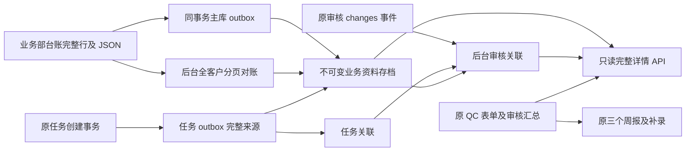

# QC 完整业务资料：存档、关联与只读查看

## 当前边界

本功能已在本地日常系统启用：正式仓库源码运行于5173/8000/3411，通过私有绝对路径配置继续使用原业务数据目录；主库按正式 Alembic 链升级0194并完成QC存档准备和采集。通用开发设置仍默认关闭；生产是否启用必须以发布门禁结果为准。UI 改动涉及验货汇总详情，并按最终验收反馈删除汇总页独立「导出 Excel」按钮及专用前后端实现。历史导入/批次管理和报告中心导出保留。主表八列、客排期14列、任务推送、草稿 revision、审核状态机、报表统计及三份周报 Excel 均保留。

数据职责：业务部 `OrderLedgerLine` 仍是订单权威源；`qc_dossier` 仅存观察到的业务证据。QC 填写仍由 workflow/inspection-sheet 保存；审核事件与 `approved_snapshot` 仍由既有审核事务保存；summary 是查询投影，不是这些数据的替代数据库。



## 来源与字段

源系统固定为 `sales.customer-order-ledger.schedule`；厂区、稳定行 ID、业务 version/revision、原创建/更新时间、映射版本、内容 SHA256、实际观察时间分别保存。保存所有 `OrderLedgerLine` 列与全部 `data` JSON，包括新增未知业务键。Decimal 数量按原 SQL Numeric(18,4) 固定小数文本保存；JSON 内的 null、空串、0、false、对象、数组和编号文本不转换。源附件仅保存受控 ID、文件名、SHA、kind，不复制 BLOB，不新增附件下载入口。凭据类键与附件正文拒绝进入存档；源 API 临时计算的 remaining_quantity 可由数量/走货量按原规则计算，dispatch_status 是业务分发状态，不冒充 QC 审核状态，当前未作为独立业务事实字段存档。

客 Q、行 Q、requested_ship_date、received_date、product_name_zh/en、packaging、units_per_carton、carton_count、standard、date_code、label、customer_label、contract_no、reference_no、po_no、production_no、note、remarks 均按来源原值保存。业务模板生成的 Q 日期仍是原始来源值，不自动提升为计划或推送资格。业务数据本身缺失就保持缺失；没有原始附件元数据的旧快照不补造引用。

## 持久化和事务

主 SQL：Alembic `20261110_0194`，父 `20261107_0193`。仅新增 `qc_dossier_outbox`（id、factory、source_id、payload、created_at、delivered_at、attempts、last_error），包含 pending、factory、source 索引。SQLAlchemy Session 监听与 service.lock_line 标记在原业务事务中留存完整来源；原业务回滚时 outbox 一并回滚。源 outbox 保存失败会使该源订单事务失败，不声称保留了未保存的资料。仅在开关开启时运行；HTTP 与 CLI 的 ledger service 都注册监听。绕过应用直接写数据库的操作只能由周期对账发现最终状态，无法保证保留两次扫描之间所有中间状态。

`_inspection_sheet/inspections.sqlite3` 显式增加：

| 表 | 关键职责 |
| --- | --- |
| qc_dossier_schema | 存档结构版本 |
| source_captures | 完整 payload、来源身份/版本、内容哈希，按厂区/来源/哈希去重 |
| source_observations | 原始事件键、观察时刻、capture_id、类型、内容变化/同版本冲突提示 |
| source_heads | 厂区/来源的最近观察，不以迟到旧版本覆盖较新版本 |
| dossier_links | 任务/entry/审核事件的关联、证据、状态、时间 |
| dossier_events | 不可变采集变化/关联变化记录 |
| dossier_worker_state | 最近成功批次、审核轮转游标 |

`_workflow/workflow.sqlite3` 显式增加 `dossier_outbox`（id、factory、task_id、source_id、payload、observed_at、delivered_at、attempts、last_error）。与创建任务在同一个 SQLite 事务、独立 savepoint 留存完整来源，不扩大原 sourceRecord。资料存档交付暂时失败不阻止原验货流程；队列保留原 payload 和时间继续重试。任务来源证据入队本身失败时保留原任务并记录关联失败日志，不能伪造当时证据；之后若无可信证据，只能保持未关联。

索引覆盖 factory/source/version、观察时间、entry/audit、task、来源事件与队列待处理查询。capture/observation/events 有拒绝 UPDATE/DELETE 的触发器；已成功关联不替换成其他 capture。其余业务表及旧快照不回填。

后台由 FastAPI lifespan 启动；默认30秒循环，最短10秒，耗时批次后再等待。源事件和任务队列按尝试次数轮转，避免坏事件永久挡住后续事件；每轮源对账按 ID 分页100行遍历配置厂区所有客户及订单状态，不受页面筛选影响。审核关联按游标分页100条，循环回访历史缺失。无变化对账更新观察心跳，不重复创建完整 JSON/日志。多进程重复交付靠事件键、内容哈希及数据库事务幂等。SQLite 写入等待250ms后失败重试；大吞吐/生产 PostgreSQL 并发容量仍需真实环境压测。

## 时间与历史关联

- 任务关联：同任务事务保存的原始 payload 是确切证据。
- 审核关联：确认事件对应的 sourceRecord 身份、版本及原有限字段一致，并且观察发生于审核前。若有匹配的确切任务 outbox，优先选用该份资料；否则仅在符合条件的原始业务内容唯一时关联。
- UI「审核时关联资料」指审核关联到的可信来源，可能是任务创建时冻结的资料，不声称业务部在审核时重新签署了这些要求。
- 同版本存在不同业务内容但无确切任务证据，显示歧义；只采到审核后的最新资料，显示历史未采集。相同 PO 不用于拼接身份。
- 反审核/退回维持原流程，失效 summary 无法经新 API 查看为当前有效结果；再次确认关联新的真实审核事件，旧关联保留。
- 无法还原的历史操作者显示未知。note/remarks 不冒充 QC 手填；QC备注直接读取有效审核快照；空备注隐藏，不从业务备注或历史日志补值。

## API 与权限

`GET /api/qc-department/{factory}/u-{actor_hash}/api/inspection-dossier/records/{summary_id}`

沿用当前登录、authorization_version、QC read、厂区/company 校验；只接受32位汇总 ID，校验 active record 与同厂 entry。POST/HEAD 拒绝；没有 sourceId 任意查询入口。依照原 QC 模块厂区权限，不新造逐用户私有订单权限。

返回 qc / business(frozen,task,latest,status) / audit / changes / sourceEvents / remarkOrigin / fieldPolicy。普通 QC 仅得到明确工作字段的标量白名单；嵌套结构、价格、联系人、未知扩展和文件元数据需要同厂区 sales-business 的 customer_order:read，后端裁剪，差异历史也遵循相同裁剪。授权用户可直接查看有效业务扩展字段，技术来源信息在修改记录内展开。照片继续走既有认证接口，没有新下载/上传权限。

主汇总和 inspection 存档使用 URI mode=ro + query_only；GET 不调用 store、sync、reconcile 或迁移。缺失档案库返回 not_initialized，缺少历史关联返回 missing/ambiguous（页面显示“暂无可确认的历史业务资料”）；独立 collection 状态区分 disabled/pending/collecting/ready/failed，超时状态标记失败，不向厂区页面暴露跨厂汇总计数；无效记录404，损坏哈希/来源身份或数据库读取异常503，不私自修复。

## UI 和报告兼容

真实 `qc-inspection-summary.js/css` 实现原540px右侧详情，顶部四组固定为 QC验货、业务资料、审核记录、修改记录。每次打开默认第一组；关闭保持主表筛选/分页/滚动，保留原焦点和照片查看器。业务分组直接显示本次审核可靠关联资料，不设置来源选择框；完整来源与版本保留在修改记录的技术折叠项。技术来源折叠在修改记录；业务资料空字段与空分组隐藏、0/false与文本前导零保留、文本 HTML 转义，对象/数组用可读列表。查看照片直接打开独立预览，不再滚动回同一份详情；详情与照片各保持单实例并在关闭时释放异步和全局手势监听器。无新的订单编辑/审核操作。

三份模板仍按原规则取已审核值和已保存人工补录；本实现不将“最近业务资料”灌入既有模板。未来适配器必须显式选定审核关联字段及业务含义，再讨论补录优先级；包装方式不等于每箱数量，FAIL不等于退货，业务 Q 不等于 QC 最终日期。

## 本地启用、备份及恢复

不得直接把下列路径替换为生产路径执行。独立副本演练通过后，本地日常系统已完成启用。其他环境正式启用前必须停写并做主SQL、workflow、inspection、summary以及原报告/附件目录的完整一致备份，校验备份可读、数量/哈希与恢复。先确认当前 Alembic 版本，再升级0194；不能用 stamp 隐藏旧库结构漂移。

示例仅表示调用方式，所有变量必须显式指向已批准的隔离/本地环境：

```sh
# 在正式仓库 backend 下，环境已显式指定 DATABASE_URL 与 QC_DEPARTMENT_DATA_DIR
.venv/bin/python -m alembic upgrade 20261110_0194
.venv/bin/python scripts/qc_dossier_maintenance.py status
.venv/bin/python scripts/qc_dossier_maintenance.py migrate --apply
# 确认两个显式迁移成功后才设置 QC_DOSSIER_ENABLED=true
.venv/bin/python scripts/qc_dossier_maintenance.py collect --apply
```

SQLite maintenance migrate 会先用 SQLite backup API 备份现有两个文件，再执行仅新增表/索引/触发器的事务。它不会自动升级主SQL。启用时校验表，缺失则明确拒绝错误启动；默认关闭不会强迫日常库迁移。工厂范围由 QC_DOSSIER_FACTORIES 配置，当前默认仅 huaxing。

恢复应先停写，按同一备份点恢复业务库，保留现有原件和增量证据。仅恢复 archive 而 outbox 已确认交付时，普通 pending 扫描不足以补齐，必须显式执行：

```sh
.venv/bin/python scripts/qc_dossier_maintenance.py recover --apply
```

该命令从保留的主库/任务 outbox 重放原 payload/原观察时间（包括已确认的事件），再正常对账与审核关联；不能用当前订单反造旧资料。没有原 outbox 的历史证据无法恢复。关闭功能开关是安全回退方式；保留新增表及旧应用数据，不删除已采证据。非空主库 outbox downgrade 明确拒绝；禁止拿整库旧备份覆盖其后的 QC 工作。

## 版本化发布与自动启用

仓库实际入口是 `deploy/update-from-github.sh`、`docker-compose.prod.yml` 和 `Dockerfile.backend`。本次没有登录生产服务器核实它当前使用的覆写配置或执行发布。

发布脚本维护窗口内停止 API、文档 worker、QC 服务；从停止的原 API 完整备份 QC 目录，并备份 QC 服务全部工作簿/附件以及 PostgreSQL。校验 pg_dump 校验和与 pg_restore 目录后，新镜像通过 `qc_dossier_release.py prepare` 将原 QC 目录保全到持久卷，检查 SQLite 完整性，显式运行主库0193→0194新增迁移、独立资料表幂等迁移并写准备标记。非空目的卷若与旧容器备份不同则拒绝覆盖；部分失败保留旧容器和所有备份，不自动还原整库。旧于0193或未知版本必须先按其既有升级流程解决，不能用 stamp 绕过。

Compose 为 API 固定提供 `QC_DOSSIER_ENABLED=true`，不依赖记住手动开关；Docker 启动先核对准备标记和实际结构。后台完整扫描后，发布脚本轮询 `verify` 的来源覆盖、待处理队列、最近成功状态及详情只读检查，随后才解除维护。失败明确阻止完成，保留维护页。发布是单 API 停写切换，避免旧新 SQLite 写入者交叠。

紧急关闭：在部署环境设置 `QC_DOSSIER_EMERGENCY_DISABLED=true` 并按授权流程重新创建 API。普通开发环境仍可用 `QC_DOSSIER_ENABLED=false`。两者只停采集，不删除档案，不更改原验货、审核、汇总和报表契约。紧急关闭状态会在就绪检查中明确输出 emergency-disabled，不能称为完整资料已启用。

重复 prepare 会先备份，再幂等验证；重复正常发布先 verify。中途失败后的恢复应先核对停写状态、已保留容器及同一备份点，禁止无判断覆盖新工作。新增字段迁移之外的历史迁移不由本脚本擅自执行。正式服务器的额外直写程序、持久卷覆盖配置和数据库版本必须符合发布前提；否则不得把源码演练当作生产验收。

## 照片双版本持久化

照片继续使用验货单现有 photoId、entryId、厂区权限及软删除规则。原始字节和经过方向校正、去 EXIF 的 JPEG 预览图分别存于 QC 数据目录 `_inspection_sheet/photo-files`，`inspections.sqlite3` 内新增 `photo_assets` 元数据表；新照片不向旧 content 列写入大 BLOB，旧 BLOB 和历史确认快照保留。无需新增 Alembic 迁移，验货单本地 schema 初始化幂等创建表。

上传保留原图后生成预览；预览失败保留原图和失败状态，后台重试。事务回滚清理本次产生的文件；中断后仅清理超过 24 小时且不被任何元数据引用的生成文件。已软删除照片的文件仍保留。备份和恢复必须将整个 QC 数据目录（数据库及照片文件）作为同一恢复点处理，不能只复制 SQLite 文件。

历史补齐只派生预览，不修改原验货单 revision、审核或照片 ID。只有原 workflow 附件经旧归一化算法计算的摘要与历史照片匹配时，才标记原图可用；否则明确显示“原图不可用”，不能从预览恢复原始照片。

汇总默认读取预览，原图按需加载，读取与缓存重验证均先经过原厂区、验货记录、照片权限检查。JPEG/PNG 原始高清导出直接嵌入原始字节；HEIF/WebP 或需要方向校正的图片使用全分辨率兼容 PNG，原存储文件不变。月度问题图文导出按实际照片数量显示清晰度选择，默认预览；缺少历史原图必须提示数量并获得明确替代同意。无照片导出及三个周报模板保持原流程。

## 验证范围与环境边界

独立运行环境已使用真实 Alembic 创建0193基线，再通过发布准备升级0194，重复准备通过；保留原验收副本；本地日常升级另外经过原库副本演练和原有412张表值保全核验，生产数据库未操作。真实 Chrome DevTools 完成四组内容、540px桌面、窄屏、照片循环、不同记录、断网重试及延迟关闭验收，截图在 outputs 修复报告目录。业务源使用明确标记的历史快照回放，QC 操作仅为隔离测试。

本地 Docker CLI 可用但守护进程未运行，因此容器级 PostgreSQL 发布、真实服务器停写边界、生产备份恢复和物理手机/Safari手势未实测；脚本准备不能称为线上已启用。
