# 纸箱供应商协同使用教程

从纸箱供应商协同页面右上角的“使用教程”打开，可查找步骤、进入对应供应商页面，并使用“打印 / 保存 PDF”。先核对采购与目的厂区，再接单、登记真实发货、跟进仓库反馈；月底核对送货、退货与应结金额，本月对账只读，无需系统内确认。内部仓管操作见[纸箱模块使用教程](纸箱模块使用教程.md)。

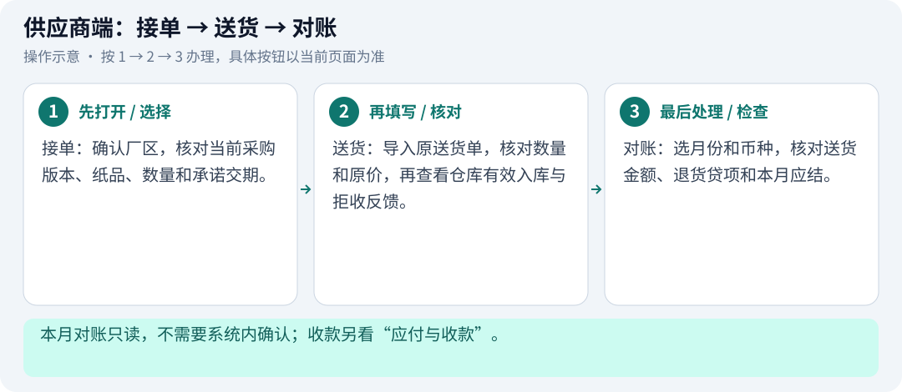

配图为操作示意及演示数据，实际办理以目的厂区、账号权限和真实业务为准。

## 01 先选厂区，再看订单

**首次启用 · 位置：纸箱供应商协同 → 页面顶部 / 订单管理**

按订单目的厂区办理，避免送错地方。

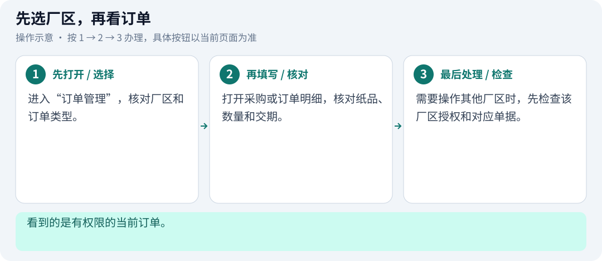

操作示意图；按图中 1 → 2 → 3 办理，按钮与数据以当前页面为准。

1. 进入“订单管理”，核对厂区和订单类型。
2. 打开采购或订单明细，核对纸品、数量和交期。
3. 需要操作其他厂区时，先检查该厂区授权和对应单据。

**完成后检查：** 看到的是有权限的当前订单。

**操作时留意：**

- 供应商负责接单和发货；仓库负责验收、仓位和入库。

## 02 核对后确认接单

**每天工作 · 位置：订单管理 → 明细 / 确认接单 / 批量接单**

按当前采购版本安排生产和送货。

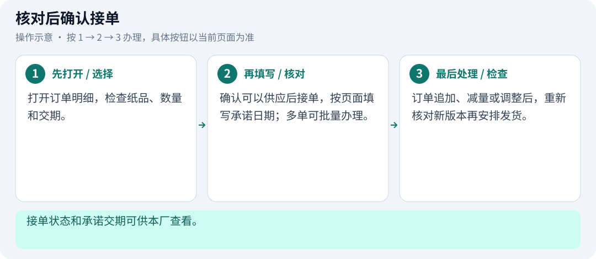

操作示意图；按图中 1 → 2 → 3 办理，按钮与数据以当前页面为准。

1. 打开订单明细，检查纸品、数量和交期。
2. 确认可以供应后接单，按页面填写承诺日期；多单可批量办理。
3. 订单追加、减量或调整后，重新核对新版本再安排发货。

**完成后检查：** 接单状态和承诺交期可供本厂查看。

**操作时留意：**

- 批量操作有失败项时先看结果，不要重复操作已成功的单。

## 03 查看和下载采购单

**每天工作 · 位置：采购单与送货单 → 筛选 / 明细 / 导出东康导入模板**

正单、样板和杂单都可以查看已生成采购。

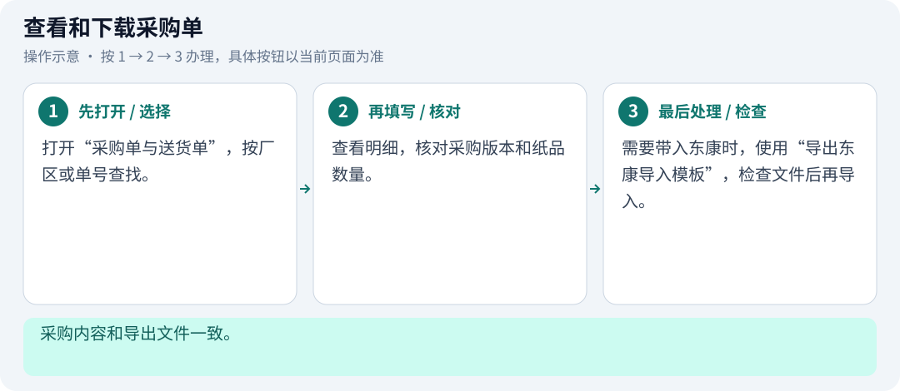

操作示意图；按图中 1 → 2 → 3 办理，按钮与数据以当前页面为准。

1. 打开“采购单与送货单”，按厂区或单号查找。
2. 查看明细，核对采购版本和纸品数量。
3. 需要带入东康时，使用“导出东康导入模板”，检查文件后再导入。

**完成后检查：** 采购内容和导出文件一致。

**操作时留意：**

- 导出采购单不等于已发货，也不会产生入库。

## 04 导入原送货单

**每天工作 · 位置：订单管理 → 导入送货单；发货与仓库反馈**

按实际发货登记，价格以供应商原单为依据。

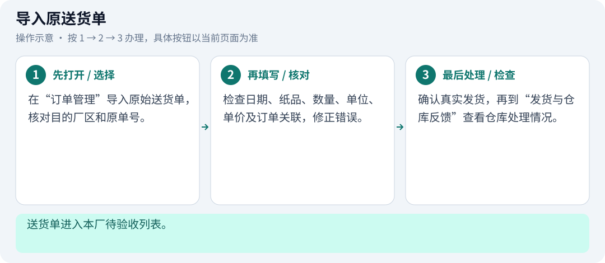

操作示意图；按图中 1 → 2 → 3 办理，按钮与数据以当前页面为准。

1. 在“订单管理”导入原始送货单，核对目的厂区和原单号。
2. 检查日期、纸品、数量、单位、单价及订单关联，修正错误。
3. 确认真实发货，再到“发货与仓库反馈”查看仓库处理情况。

**完成后检查：** 送货单进入本厂待验收列表。

**操作时留意：**

- 仓库已经手工入库的同一批货，使用后补凭证关联已有入库，不能再形成一次实收。
- 样板、杂单在原表客户单号填写真实 SP 订单编号；系统按当前已接单版本匹配纸品，保留样板、杂单来源。
- 正单、样板和杂单可放在同一张真实送货单中；任何一行需核对时，整张单不能提交。
- 缺价需补价；零价只有明确免费才作为免费处理。

## 05 看仓库实际验收结果

**每天工作 · 位置：发货与仓库反馈 → 送货单明细 / 验收历史**

到货数量包括拒收部分，入库只算有效数量。

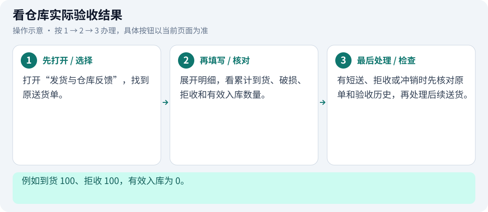

操作示意图；按图中 1 → 2 → 3 办理，按钮与数据以当前页面为准。

1. 打开“发货与仓库反馈”，找到原送货单。
2. 展开明细，看累计到货、破损、拒收和有效入库数量。
3. 有短送、拒收或冲销时先核对原单和验收历史，再处理后续送货。

**完成后检查：** 例如到货 100、拒收 100，有效入库为 0。

**操作时留意：**

- 未到不等于拒收；整项拒收不代表采购欠数已清零。

## 06 本月对账：看金额和明细

**需要时处理 · 位置：月结对账 → 本月对账 / 应付与收款**

和本厂核对同一月份的送货、退货和应结。

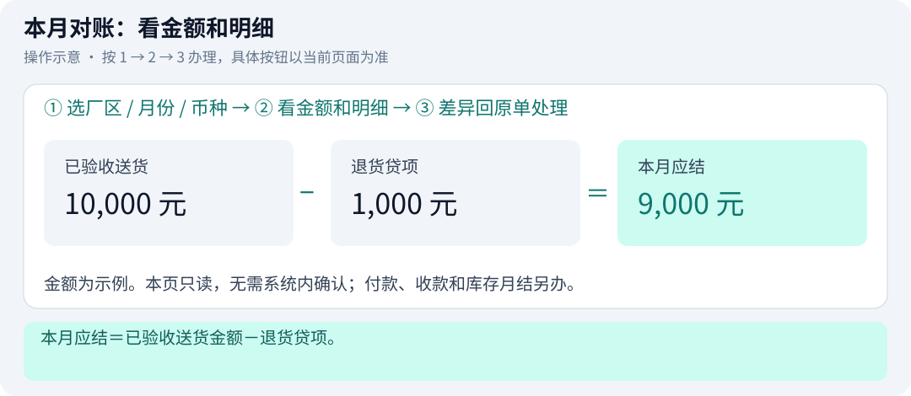

操作示意图；按图中 1 → 2 → 3 办理，按钮与数据以当前页面为准。

1. 打开“月结对账 → 本月对账”，选择厂区、月份和币种。
2. 先看已验收送货、退货贷项和本月应结，再查具体送货或退货明细。
3. 数量或价格不对时联系本厂核实原单，处理后刷新；收款另看“应付与收款”。

**完成后检查：** 本月应结＝已验收送货金额－退货贷项。

**操作时留意：**

- 本页只读，不需要在系统内确认或提异议；月结按原流程办理。
- 不把仓库期初库存或车间领用当成新增供货或退货。

## 07 上传并核对箱唛资料

**需要时处理 · 位置：箱唛资料库 → 快速上传 / 共享厂区 / 状态**

原文件与 PDF 要核对同一份内容。

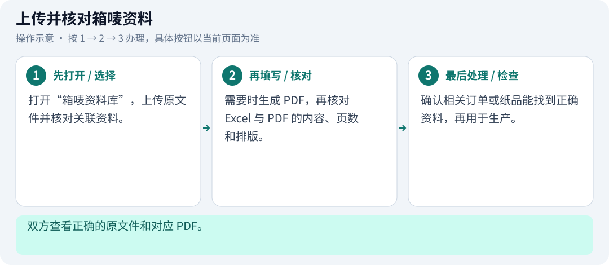

操作示意图；按图中 1 → 2 → 3 办理，按钮与数据以当前页面为准。

1. 打开“箱唛资料库”快速上传，选择初稿、待确认、已确认或历史版本，可关联多个订单。
2. 共享厂区默认不选；勾选服务厂区后，该厂业务和仓库可查看并更新资料状态。
3. 业务确认打板回稿后更新为已确认，供应商核对文件及关联订单后使用。

**完成后检查：** 双方查看正确的原文件和对应 PDF。

**操作时留意：**

- 已发送给自己的订单所共享的箱唛随订单可读；上传、改状态和维护关联仍需独立资料权限。
- 转换成功不代表内容正确，使用前仍需核对。

## 08 失败或超时先查原单

**需要时处理 · 位置：当前页面提示；采购单与送货单 / 操作日志**

先看结果，避免重复接单或发货。

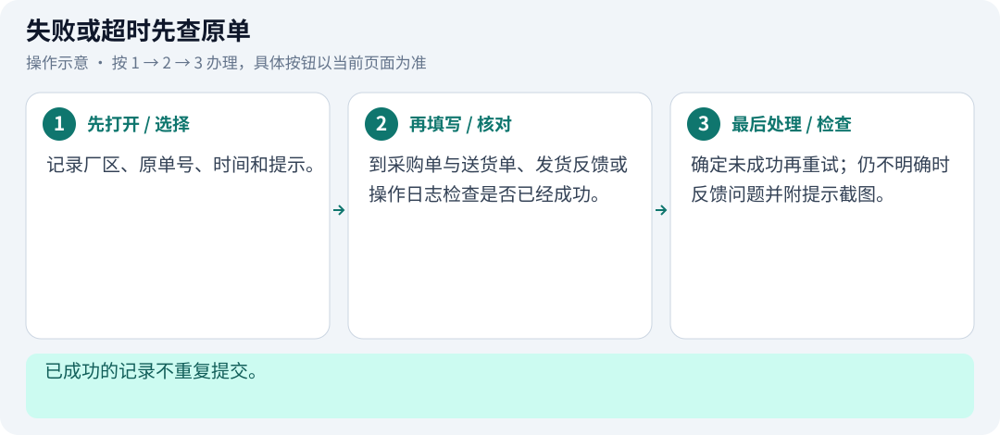

操作示意图；按图中 1 → 2 → 3 办理，按钮与数据以当前页面为准。

1. 记录厂区、原单号、时间和提示。
2. 到采购单与送货单、发货反馈或操作日志检查是否已经成功。
3. 确定未成功再重试；仍不明确时反馈问题并附提示截图。

**完成后检查：** 已成功的记录不重复提交。

**操作时留意：**

- “已保存但刷新失败”只需重新读取，不能当作没保存。

## 09 反馈问题与查看更新

**需要时处理 · 位置：页面右上角 → 反馈与变更**

说明问题发生在哪张单，便于处理。

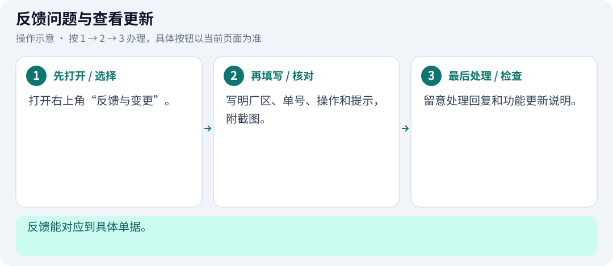

操作示意图；按图中 1 → 2 → 3 办理，按钮与数据以当前页面为准。

1. 打开右上角“反馈与变更”。
2. 写明厂区、单号、操作和提示，附截图。
3. 留意处理回复和功能更新说明。

**完成后检查：** 反馈能对应到具体单据。

**操作时留意：**

- 截图避开密码和无关个人信息。

## 10 样板、杂单与免费赠送

**每天工作 · 位置：订单管理 → 订单台账 → 类型筛选**

样板和杂单沿用订单接单、采购单和送货流程。

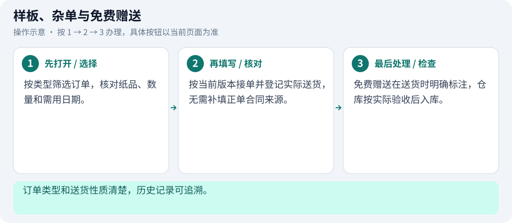

操作示意图；按图中 1 → 2 → 3 办理，按钮与数据以当前页面为准。

1. 按类型筛选订单，核对纸品、数量和需用日期。
2. 按当前版本接单并登记实际送货，无需补填正单合同来源。
3. 免费赠送在送货时明确标注，仓库按实际验收后入库。

**完成后检查：** 订单类型和送货性质清楚，历史记录可追溯。

**操作时留意：**

- 样板不等于免费；追加和修改后仍需核对新版本。

## 每天收尾检查

勾选仅用于自查，不会修改业务记录。

- [ ] 核对厂区和当前采购版本。
- [ ] 接单、交期承诺与实际安排一致。
- [ ] 送货单数量和原价填写清楚。
- [ ] 跟进仓库有效入库、拒收和短送反馈。
- [ ] 核对本月送货、退货与应结，差异回原单处理。
