# 纸箱供应商协同使用教程

先选对目的厂区，核对当前采购后接单，按真实数量发货，再看仓库实际验收结果。本月对账只读，先核对厂区、月份和币种，有差异回原单查。报错先查是否成功，别重复接单或发货。页面右上角“使用教程”可查找步骤和“打印 / 保存 PDF”。仓管请看[纸箱模块使用教程](纸箱模块使用教程.md)。

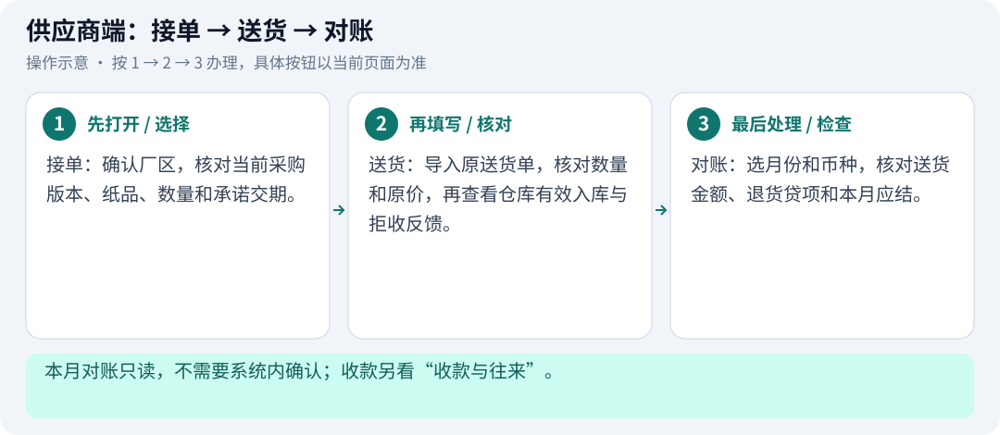

配图为操作示意及演示数据，实际办理以目的厂区、账号权限和真实业务为准。

## 01 先选厂区，再看订单

**首次启用 · 位置：纸箱供应商协同 → 页面顶部 / 订单管理**

按订单目的厂区办理，避免送错地方。

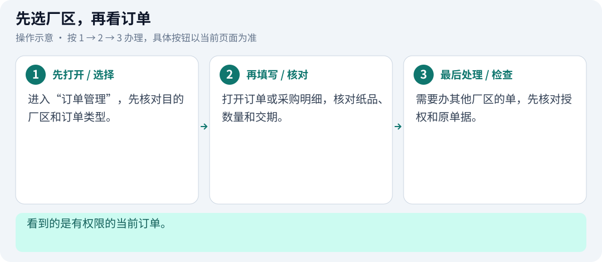

操作示意图；按图中 1 → 2 → 3 办理，按钮与数据以当前页面为准。

1. 进入“订单管理”，先核对目的厂区和订单类型。
2. 打开订单或采购明细，核对纸品、数量和交期。
3. 需要办其他厂区的单，先核对授权和原单据。

**完成后检查：** 看到的是有权限的当前订单。

**操作时留意：**

- 供应商负责接单和发货；仓库负责验收、仓位和入库。

## 02 核对后确认接单

**每天工作 · 位置：订单管理 → 明细 / 确认接单 / 批量接单**

按当前采购版本安排生产和送货。

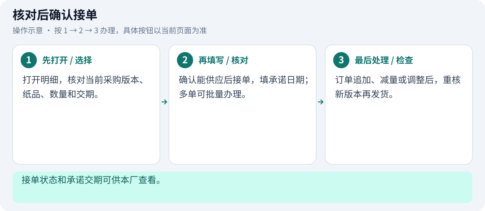

操作示意图；按图中 1 → 2 → 3 办理，按钮与数据以当前页面为准。

1. 打开明细，核对当前采购版本、纸品、数量和交期。
2. 确认能供应后接单，填承诺日期；多单可批量办理。
3. 订单追加、减量或调整后，重核新版本再发货。

**完成后检查：** 接单状态和承诺交期可供本厂查看。

**操作时留意：**

- 批量操作先看成功和失败结果，不要重做已成功的单。

## 03 查看和下载采购单

**每天工作 · 位置：采购单与送货单 → 筛选 / 明细 / 导出东康导入模板**

正单、样板和杂单都可以查看已生成采购。

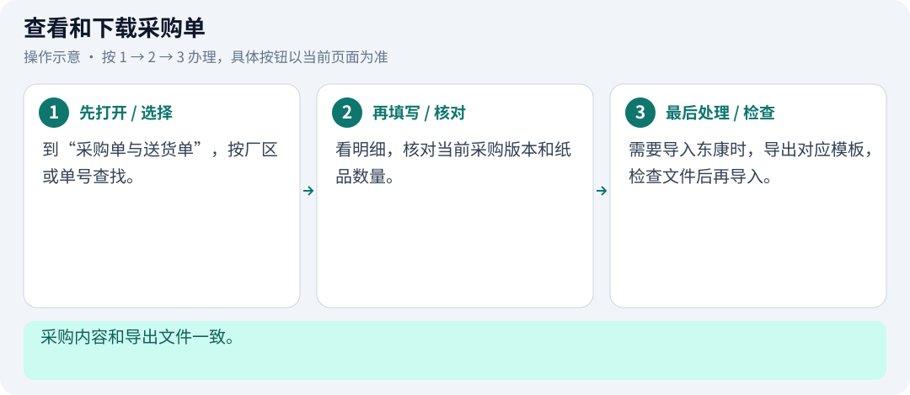

操作示意图；按图中 1 → 2 → 3 办理，按钮与数据以当前页面为准。

1. 到“采购单与送货单”，按厂区或单号查找。
2. 看明细，核对当前采购版本和纸品数量。
3. 需要导入东康时，导出对应模板，检查文件后再导入。

**完成后检查：** 采购内容和导出文件一致。

**操作时留意：**

- 导出采购单不等于已发货，也不会产生入库。

## 04 导入原送货单

**每天工作 · 位置：订单管理 → 导入送货单；发货与仓库反馈**

按实际发货登记，价格以供应商原单为依据。

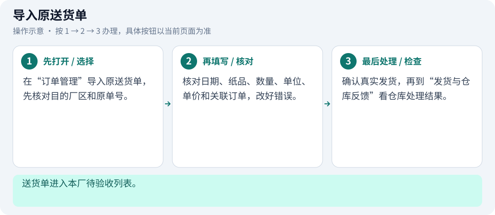

操作示意图；按图中 1 → 2 → 3 办理，按钮与数据以当前页面为准。

1. 在“订单管理”导入原送货单，先核对目的厂区和原单号。
2. 核对日期、纸品、数量、单位、单价和关联订单，改好错误。
3. 确认真实发货，再到“发货与仓库反馈”看仓库处理结果。

**完成后检查：** 送货单进入本厂待验收列表。

**操作时留意：**

- 仓库已手工入过库的同批货，要后补凭证关联原入库，不能再收一次。
- 样板、杂单在客户单号填真实 SP 订单号，按当前已接单版本匹配纸品。
- 同一张真实送货单可含正单、样板和杂单；有一行待核对，整单先不提交。
- 缺价不是免费。普通单空价或未确认免费的 0 元仍待核价；明确确认才作免费。样板、杂单零价须确认免费。
- 正式合同缺货号，先补齐原文件再导入；资料齐全却没订单的货交仓库核实。

## 05 看仓库实际验收结果

**每天工作 · 位置：发货与仓库反馈 → 送货单明细 / 验收历史**

看有效入库、拒收和短送，不只看发货数。

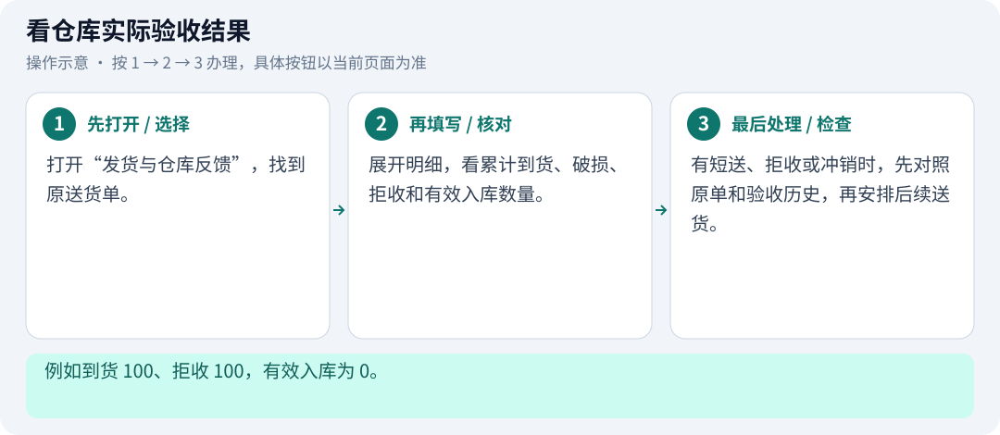

操作示意图；按图中 1 → 2 → 3 办理，按钮与数据以当前页面为准。

1. 打开“发货与仓库反馈”，找到原送货单。
2. 展开明细，看累计到货、破损、拒收和有效入库数量。
3. 有短送、拒收或冲销时，先对照原单和验收历史，再安排后续送货。

**完成后检查：** 例如到货 100、拒收 100，有效入库为 0。

**操作时留意：**

- 未到不等于拒收；全拒收时有效入库为 0，采购欠数不会因此清零。

## 06 本月对账：看金额和明细

**需要时处理 · 位置：月结对账 → 本月对账 / 应付与收款**

选同一厂区、月份和币种，和本厂核对明细。

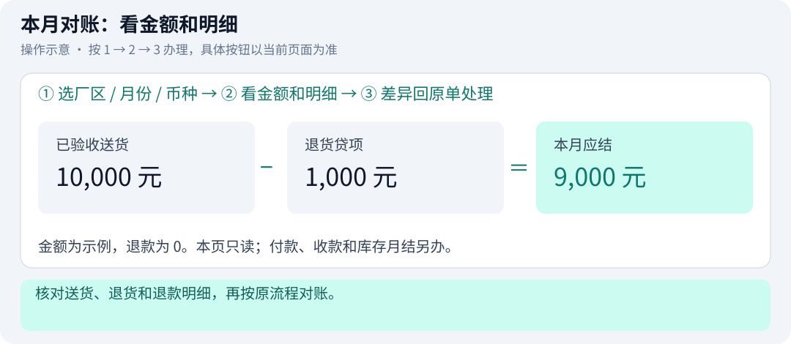

操作示意图；按图中 1 → 2 → 3 办理，按钮与数据以当前页面为准。

1. 打开“月结对账 → 本月对账”，选对厂区、月份和币种。
2. 看已验收送货、退货、退款和本月应结，展开原单明细。
3. 有差异先联系本厂核实，再刷新；收款另看“应付与收款”。

**完成后检查：** 核对送货、退货和退款明细，再按原流程对账。

**操作时留意：**

- 本页只读，无需在系统内确认或提异议；看完不代表已经收款。
- 没数据先核对筛选和厂区、月份、币种，再联系本厂查实际收料。
- 期初库存、车间领料不算新增供货或退货；缺价不是免费。

## 07 上传并核对箱唛资料

**需要时处理 · 位置：箱唛资料库 → 快速上传 / 共享厂区 / 状态**

原文件与 PDF 要核对同一份内容。

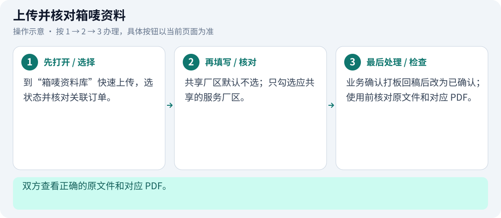

操作示意图；按图中 1 → 2 → 3 办理，按钮与数据以当前页面为准。

1. 到“箱唛资料库”快速上传，选状态并核对关联订单。
2. 共享厂区默认不选；只勾选应共享的服务厂区。
3. 业务确认打板回稿后改为已确认；使用前核对原文件和对应 PDF。

**完成后检查：** 双方查看正确的原文件和对应 PDF。

**操作时留意：**

- 勾选共享厂区后，该厂业务和仓库可查看并更新资料状态。
- 已发给自己的订单可读其共享箱唛；上传、改状态、改关联另需资料权限。
- 转换成功不等于内容正确，使用前仍要核对。

## 08 失败或超时先查原单

**需要时处理 · 位置：当前页面提示；采购单与送货单 / 操作日志**

先查有没有成功，避免重复接单或发货。

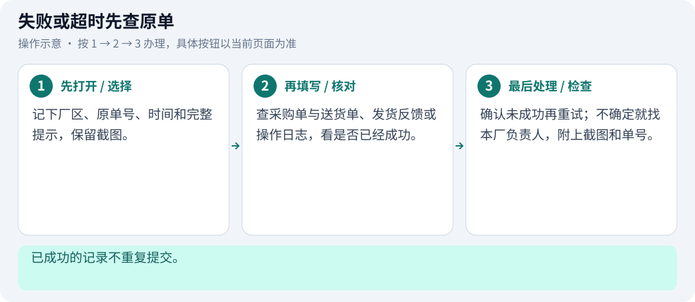

操作示意图；按图中 1 → 2 → 3 办理，按钮与数据以当前页面为准。

1. 记下厂区、原单号、时间和完整提示，保留截图。
2. 查采购单与送货单、发货反馈或操作日志，看是否已经成功。
3. 确认未成功再重试；不确定就找本厂负责人，附上截图和单号。

**完成后检查：** 已成功的记录不重复提交。

**操作时留意：**

- “已保存但刷新失败”只需重新读取，不能当作没保存。
- 不要反复点提交。当前没有“AI 自动修复”，问题须先核实。

## 09 反馈问题与查看更新

**需要时处理 · 位置：页面右上角 → 反馈与变更**

说明问题发生在哪张单，便于处理。

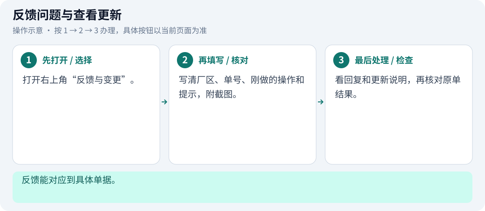

操作示意图；按图中 1 → 2 → 3 办理，按钮与数据以当前页面为准。

1. 打开右上角“反馈与变更”。
2. 写清厂区、单号、刚做的操作和提示，附截图。
3. 看回复和更新说明，再核对原单结果。

**完成后检查：** 反馈能对应到具体单据。

**操作时留意：**

- 截图避开密码和无关个人信息。

## 10 样板、杂单与免费赠送

**每天工作 · 位置：订单管理 → 订单台账 → 类型筛选**

样板、杂单是订单类型；免费要单独明确。

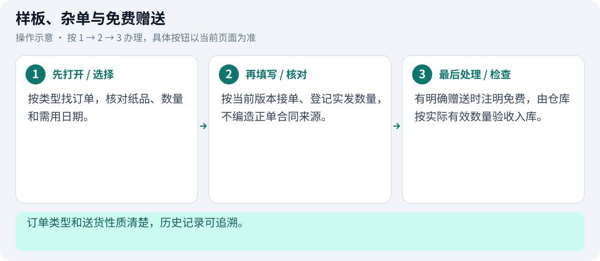

操作示意图；按图中 1 → 2 → 3 办理，按钮与数据以当前页面为准。

1. 按类型找订单，核对纸品、数量和需用日期。
2. 按当前版本接单、登记实发数量，不编造正单合同来源。
3. 有明确赠送时注明免费，由仓库按实际有效数量验收入库。

**完成后检查：** 订单类型和送货性质清楚，历史记录可追溯。

**操作时留意：**

- 样板不等于免费；追加和修改后仍需核对新版本。

## 每天收尾检查

勾选仅用于自查，不会修改业务记录。

- [ ] 核对厂区和当前采购版本。
- [ ] 接单、交期承诺与实际安排一致。
- [ ] 送货单数量和原价填写清楚。
- [ ] 跟进仓库有效入库、拒收和短送反馈。
- [ ] 核对本月送货、退货与应结，差异回原单处理。
