# 纸箱模块使用教程

从纸箱采购协同页面右上角的“使用教程”打开图文说明，可查找步骤、进入对应页面，并使用“打印 / 保存 PDF”。每个主题配一张三步示意图。新建样板／杂单可用 Excel 导入，多张原订单加量用“批量追加”；首次启用再看基础资料和期初库存。供应商操作见[供应商协同使用教程](纸箱供应商协同使用教程.md)。

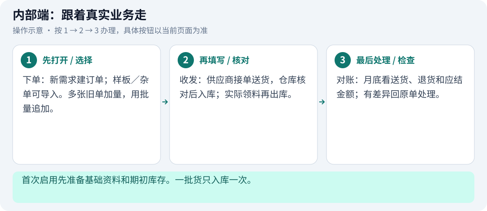

配图为操作示意及演示数据，实际办理以目的厂区、账号权限和真实业务为准。

## 01 先准备基础资料

**首次启用 · 位置：基础资料 → 基础设置 / 货号与包装**

先选对厂区，再准备客户、纸品和仓位。

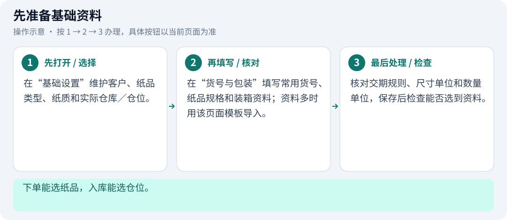

操作示意图；按图中 1 → 2 → 3 办理，按钮与数据以当前页面为准。

1. 在“基础设置”维护客户、纸品类型、纸质和实际仓库／仓位。
2. 在“货号与包装”填写常用货号、纸品规格和装箱资料；资料多时用该页面模板导入。
3. 核对交期规则、尺寸单位和数量单位，保存后检查能否选到资料。

**完成后检查：** 下单能选纸品，入库能选仓位。

**操作时留意：**

- cm、mm、inch 是尺寸单位；箱、张、个是数量单位，不能混用。
- 使用过的资料按页面允许的停用或更正流程处理，保留历史。

## 02 导入历史库存

**首次启用 · 位置：库存管理 → 期初库存**

只录上线时还在仓库里的结余。

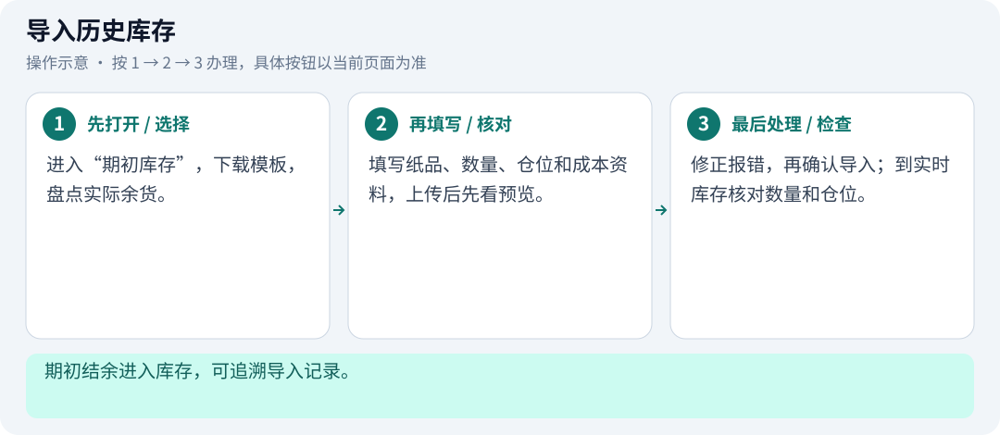

操作示意图；按图中 1 → 2 → 3 办理，按钮与数据以当前页面为准。

1. 进入“期初库存”，下载模板，盘点实际余货。
2. 填写纸品、数量、仓位和成本资料，上传后先看预览。
3. 修正报错，再确认导入；到实时库存核对数量和仓位。

**完成后检查：** 期初结余进入库存，可追溯导入记录。

**操作时留意：**

- 期初库存不等于本月新到货，不能再登记一次收料。
- 旧账款另核实，不靠重复入库补账。

## 03 旧订单要不要导入

**首次启用 · 位置：订单管理 → 订单台账 → 导入历史订单**

有剩余待收需求才需要衔接旧订单。

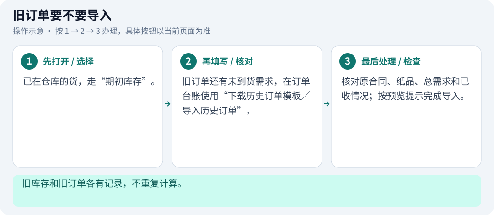

操作示意图；按图中 1 → 2 → 3 办理，按钮与数据以当前页面为准。

1. 已在仓库的货，走“期初库存”。
2. 旧订单还有未到货需求，在订单台账使用“下载历史订单模板／导入历史订单”。
3. 核对原合同、纸品、总需求和已收情况；按预览提示完成导入。

**完成后检查：** 旧库存和旧订单各有记录，不重复计算。

**操作时留意：**

- 全新样板、杂单用“新建需求模板”；给现有订单加数量用“批量追加”。

## 04 每天先看待办

**每天工作 · 位置：工作看板 → 今日待办 → 业务排期提醒**

先处理要到期的订单和已经送到的货。

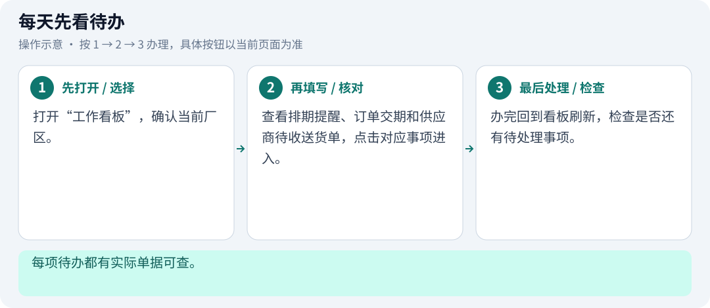

操作示意图；按图中 1 → 2 → 3 办理，按钮与数据以当前页面为准。

1. 打开“工作看板”，确认当前厂区。
2. 查看排期提醒、订单交期和供应商待收送货单，点击对应事项进入。
3. 办完回到看板刷新，检查是否还有待处理事项。

**完成后检查：** 每项待办都有实际单据可查。

**操作时留意：**

- 车间接口显示“待接入”时，不代表没有领料需求。

## 05 核对新排期

**每天工作 · 位置：订单管理 → 排期核对与交期提醒 → 下单防漏核对**

先确认需求，再决定下单。

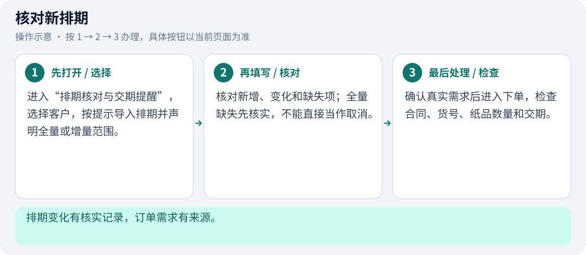

操作示意图；按图中 1 → 2 → 3 办理，按钮与数据以当前页面为准。

1. 进入“排期核对与交期提醒”，选择客户，按提示导入排期并声明全量或增量范围。
2. 核对新增、变化和缺失项；全量缺失先核实，不能直接当作取消。
3. 确认真实需求后进入下单，检查合同、货号、纸品数量和交期。

**完成后检查：** 排期变化有核实记录，订单需求有来源。

**操作时留意：**

- 排期导入成功不等于采购已发送。
- 预览后更改文件或资料，要重新核对。

## 06 新建订单并发给供应商

**每天工作 · 位置：订单管理 → 订单台账 → 新建订单 / 发给供应商**

正单、样板、杂单使用同一套下单和采购单界面。

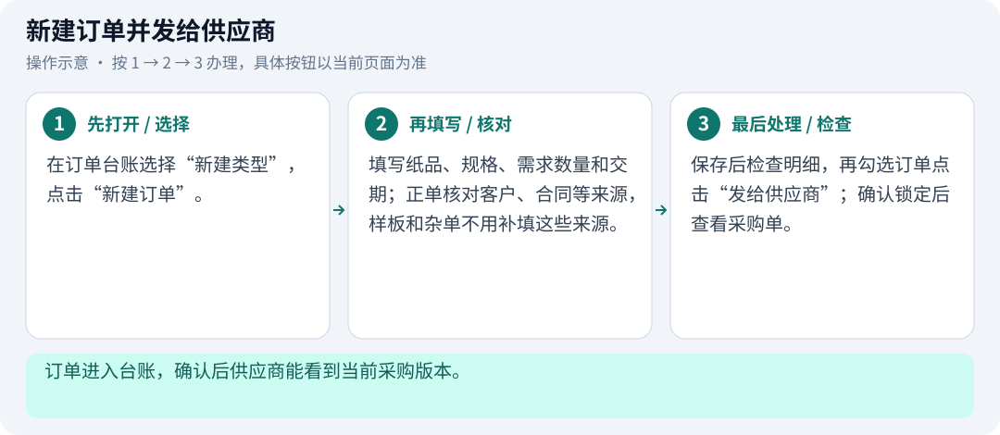

操作示意图；按图中 1 → 2 → 3 办理，按钮与数据以当前页面为准。

1. 在订单台账选择“新建类型”，点击“新建订单”。
2. 填写纸品、规格、需求数量和交期；正单核对客户、合同等来源，样板和杂单不用补填这些来源。
3. 保存后检查明细，再勾选订单点击“发给供应商”；确认锁定后查看采购单。

**完成后检查：** 订单进入台账，确认后供应商能看到当前采购版本。

**操作时留意：**

- 保存草稿不等于已发给供应商。
- 复制订单后要核实数量和日期；复制文字信息不会创建订单。

## 07 Excel 批量新建样板／杂单

**每天工作 · 位置：订单台账顶部 → 新建需求模板 / 导入样板／杂单需求**

只用于新建需求，现有订单加数量请用批量追加。

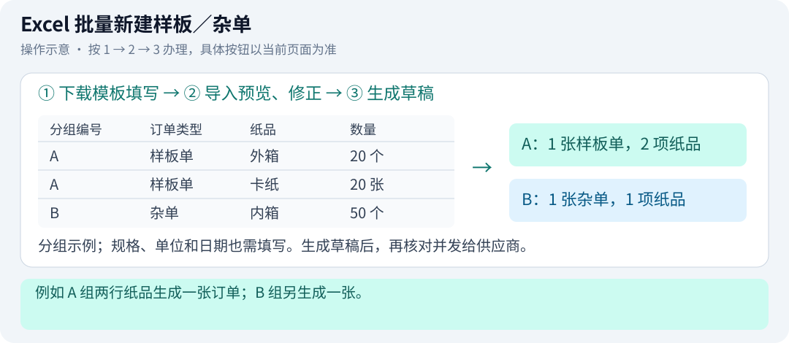

操作示意图；按图中 1 → 2 → 3 办理，按钮与数据以当前页面为准。

1. 下载“新建需求模板”，按表头填写纸品、规格、数量、单位和需用日期。同一分组编号生成一张单。
2. 点击“导入样板／杂单需求”，勾选本次需要的行，补齐空白类型和日期，修正预览错误。
3. 点击“确认生成订单草稿”，回台账核对；需要采购时再勾选并“发给供应商”。

**完成后检查：** 例如 A 组两行纸品生成一张订单；B 组另生成一张。

**操作时留意：**

- 使用系统下载的 .xlsx 模板，旧工作表先整理到模板；不要把历史订单或追加需求混进来。
- 只生成待确认草稿，不自动发给供应商、不入库。同一文件重复导入先核对已有结果。

## 08 多选订单，一次追加

**每天工作 · 位置：订单台账 → 勾选订单 → 批量追加**

追加回各自原订单，不把多张合同合成一张单。

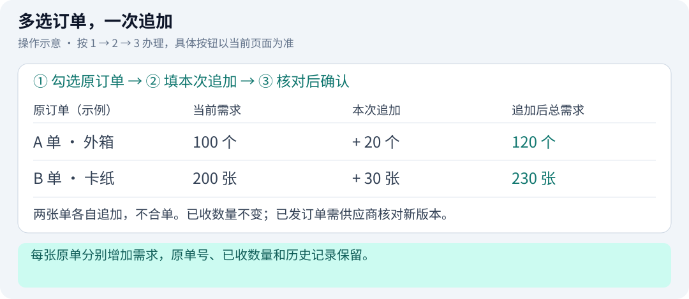

操作示意图；按图中 1 → 2 → 3 办理，按钮与数据以当前页面为准。

1. 勾选需要追加的订单，点击“批量追加”。正单、样板和杂单都可按当前状态选择。
2. 逐单填写“本次追加”和原因，核对“追加后总需求”。例如原 100、本次加 20，结果是 120。
3. 检查每张单后“确认批量追加”。回原订单看新总量和版本；已发给供应商的单要重新核对。

**完成后检查：** 每张原单分别增加需求，原单号、已收数量和历史记录保留。

**操作时留意：**

- 留空或填 0 不追加；交期留空沿用原日期。批量填本次增量，单张“追加”按字段提示填追加后总需求。
- 校验全部通过才提交；提示版本变化先刷新核实，提交超时点击“核对原提交结果”，不要另建重复订单。

## 09 上传箱唛资料

**每天工作 · 位置：订单管理 → 箱唛资料上传 / 箱唛资料库**

把资料绑定到正确合同或纸品，方便双方查看。

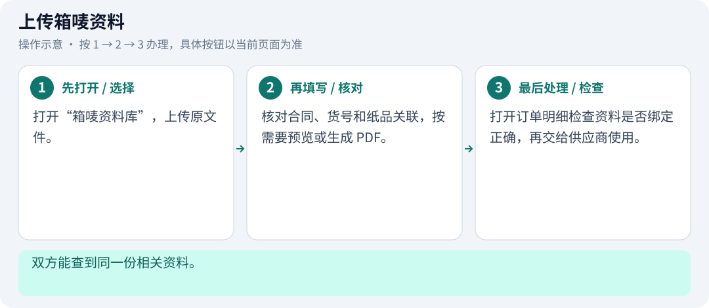

操作示意图；按图中 1 → 2 → 3 办理，按钮与数据以当前页面为准。

1. 打开“箱唛资料库”快速上传，按文件名匹配或手工关联多个订单。
2. 核对初稿、待确认、已确认或历史版本状态；同厂业务、仓库共享普通资料。
3. 在排期查看订单是否关联资料；业务可把供应商打板回稿改为已确认。

**完成后检查：** 双方能查到同一份相关资料。

**操作时留意：**

- 上传箱唛不会替你下单或改变采购数量。
- 原文件和转换后的 PDF 都要核对，转换成功不等于内容无误。

## 10 供应商接单与发货

**每天工作 · 位置：供应商：纸箱供应商协同 → 订单管理 → 发货与仓库反馈**

本厂发出采购，供应商确认后按实际情况送货。

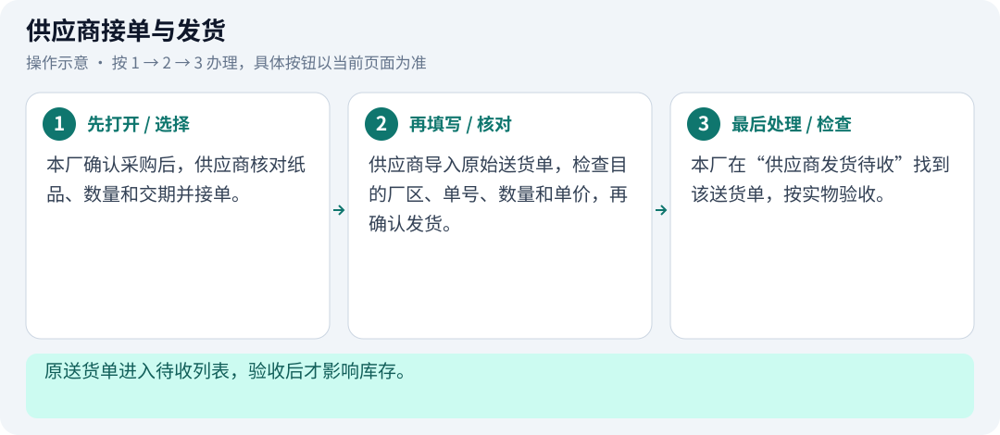

操作示意图；按图中 1 → 2 → 3 办理，按钮与数据以当前页面为准。

1. 本厂确认采购后，供应商核对纸品、数量和交期并接单。
2. 供应商导入原始送货单，检查目的厂区、单号、数量和单价，再确认发货。
3. 本厂在“供应商发货待收”找到该送货单，按实物验收。

**完成后检查：** 原送货单进入待收列表，验收后才影响库存。

**操作时留意：**

- 发货数量不等于入库数量。
- 原采购已追加或修改时，供应商要重新核对当前版本。

## 11 到货后确认入库

**每天工作 · 位置：工作看板 → 核实收料；或 收料入库 → 供应商发货待收 / 待收订单**

一批货只入库一次，按有效数量和实际仓位登记。

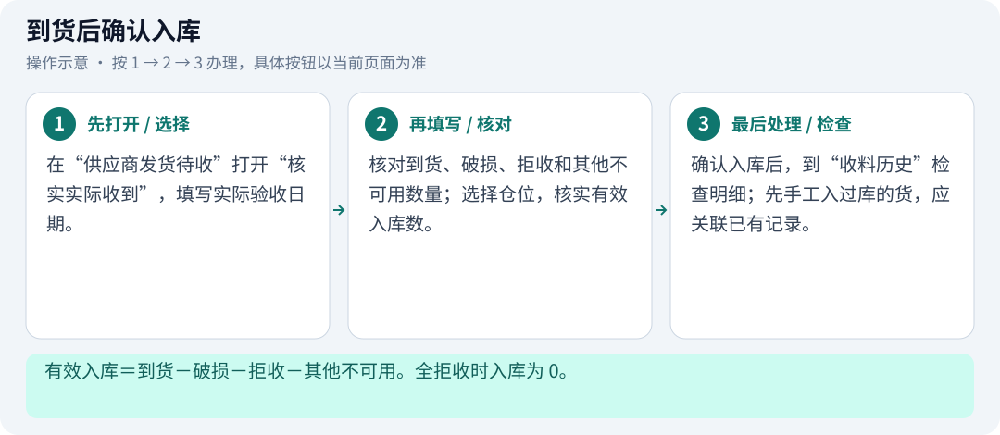

操作示意图；按图中 1 → 2 → 3 办理，按钮与数据以当前页面为准。

1. 在“供应商发货待收”打开“核实实际收到”，填写实际验收日期。
2. 核对到货、破损、拒收和其他不可用数量；选择仓位，核实有效入库数。
3. 确认入库后，到“收料历史”检查明细；先手工入过库的货，应关联已有记录。

**完成后检查：** 有效入库＝到货－破损－拒收－其他不可用。全拒收时入库为 0。

**操作时留意：**

- 供应商单价直接沿用原送货单；缺价不等于免费，可先入库再补价。手工收料自行核对单价。
- 无单货物可选样板、杂单或免费赠送入库，无需补填来源；实际属于正单才补建或关联匹配纸品。
- 余货继续待收可后续补收；短送结束只结束本送货单余量，采购欠数仍保留。

## 12 领料或发货登记出库

**每天工作 · 位置：库存管理 → 实时库存 → 出库 / 登记所选库存出库**

实物离开仓库时，再登记出库。

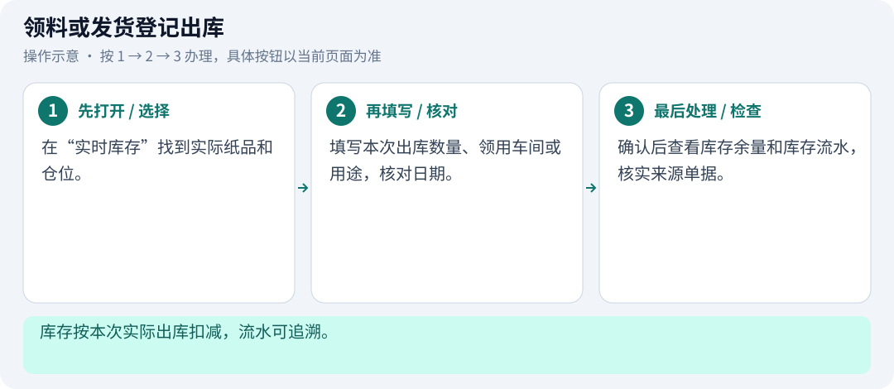

操作示意图；按图中 1 → 2 → 3 办理，按钮与数据以当前页面为准。

1. 在“实时库存”找到实际纸品和仓位。
2. 填写本次出库数量、领用车间或用途，核对日期。
3. 确认后查看库存余量和库存流水，核实来源单据。

**完成后检查：** 库存按本次实际出库扣减，流水可追溯。

**操作时留意：**

- 车间领用不等于退供应商，不能用来扣供应商货款。

## 13 加单、退货或录错怎么办

**需要时处理 · 位置：原订单 → 更多；收料入库 → 收料历史；库存管理 → 库存流水**

先分清新增需求、真实退货和录入错误。

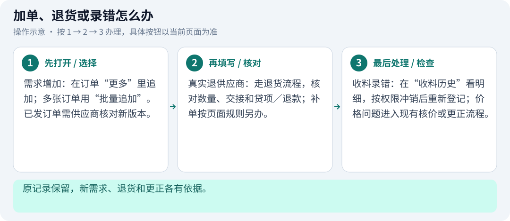

操作示意图；按图中 1 → 2 → 3 办理，按钮与数据以当前页面为准。

1. 需求增加：在订单“更多”里追加；多张订单用“批量追加”。已发订单需供应商核对新版本。
2. 真实退供应商：走退货流程，核对数量、交接和贷项／退款；补单按页面规则另办。
3. 收料录错：在“收料历史”看明细，按权限冲销后重新登记；价格问题进入现有核价或更正流程。

**完成后检查：** 原记录保留，新需求、退货和更正各有依据。

**操作时留意：**

- 已领用、锁账或已确认旧月份的记录，按页面提示先处理依赖，不能直接改历史。
- 调整订单信息需要供应商按当前流程同意；样板和杂单无需拆单、合单。

## 14 月底看金额，先处理差异

**需要时处理 · 位置：月结对账 → 本月对账 / 应付与付款 / 库存月结记录**

“本月对账”是核对汇总，不需要在这里提交确认。

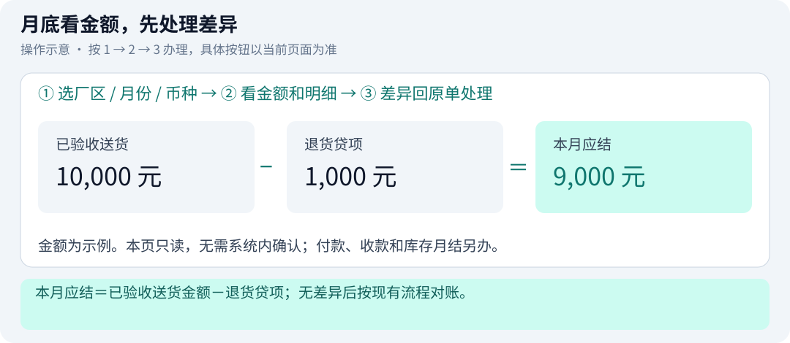

操作示意图；按图中 1 → 2 → 3 办理，按钮与数据以当前页面为准。

1. 进入“月结对账 → 本月对账”，选择厂区、月份和币种。
2. 先看已验收送货、退货贷项和本月应结；有待处理项就打开原单核实数量、价格或退货依据。
3. 处理后刷新再核对。付款看“应付与付款”，库存结余另看“库存月结记录”。

**完成后检查：** 本月应结＝已验收送货金额－退货贷项；无差异后按现有流程对账。

**操作时留意：**

- 本页只读，不确认、不锁账，也不会生成付款。对账完成不表示已付款。
- 按实际验收月份归属；期初库存、车间领用不算供应商新增进货。
- 缺价不是免费。供应商原价用于应结核对，不能据此认定已入库成本被改写。

## 15 报错或超时先查记录

**需要时处理 · 位置：当前弹窗 / 页面失败提示；相关台账、导入历史、收料历史、库存流水、操作日志**

先确认有没有成功，再决定是否重试。

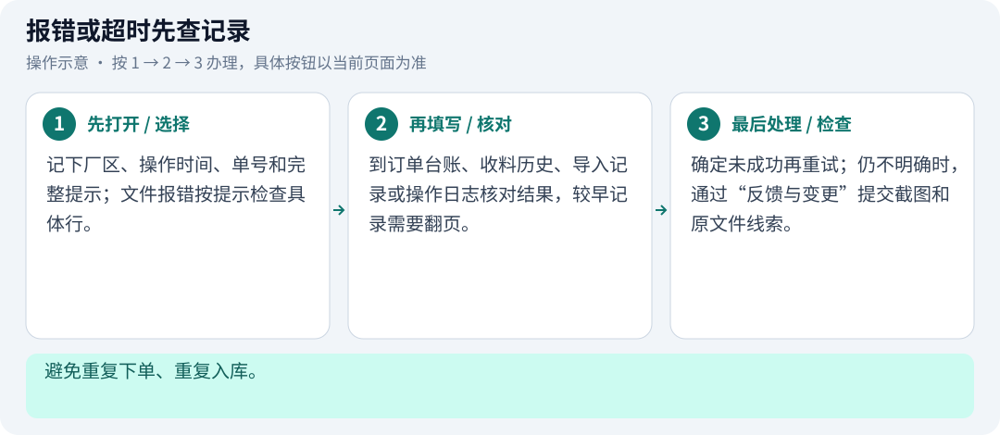

操作示意图；按图中 1 → 2 → 3 办理，按钮与数据以当前页面为准。

1. 记下厂区、操作时间、单号和完整提示；文件报错按提示检查具体行。
2. 到订单台账、收料历史、导入记录或操作日志核对结果，较早记录需要翻页。
3. 确定未成功再重试；仍不明确时，通过“反馈与变更”提交截图和原文件线索。

**完成后检查：** 避免重复下单、重复入库。

**操作时留意：**

- 提示“已保存，但刷新／下载失败”时，先刷新或重新下载，不要重新提交业务。
- 读取超时可重新读取；提交超时要先核对原提交结果。

## 16 有问题怎么反馈

**需要时处理 · 位置：页面右上角 → 反馈与变更**

把出错位置和提示一起发给负责人。

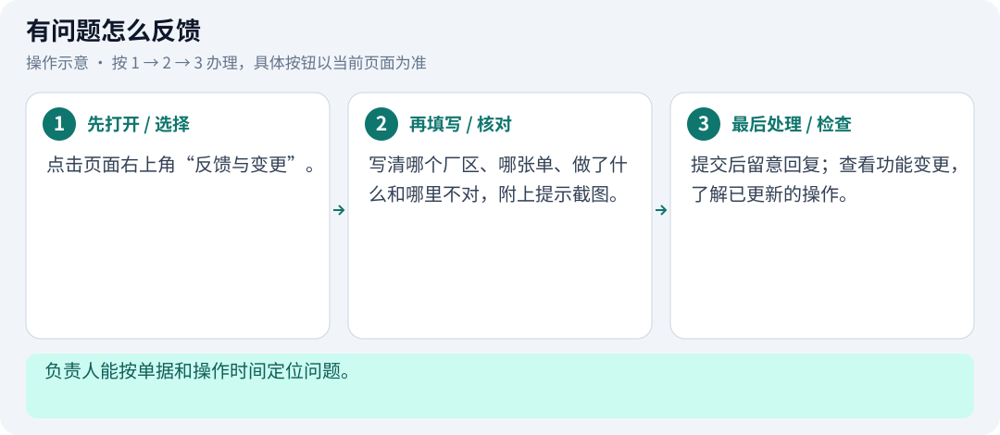

操作示意图；按图中 1 → 2 → 3 办理，按钮与数据以当前页面为准。

1. 点击页面右上角“反馈与变更”。
2. 写清哪个厂区、哪张单、做了什么和哪里不对，附上提示截图。
3. 提交后留意回复；查看功能变更，了解已更新的操作。

**完成后检查：** 负责人能按单据和操作时间定位问题。

**操作时留意：**

- 截图避开密码和无关个人信息。

## 17 样板、杂单、赠送怎么选

**每天工作 · 位置：订单管理 → 新建订单 → 正单 / 样板 / 杂单；收料入库 → 供应商发货待收**

类型不同，采购、明细和更多操作仍沿用同一套界面。

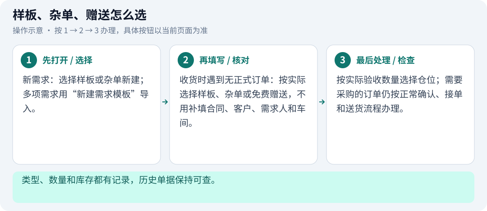

操作示意图；按图中 1 → 2 → 3 办理，按钮与数据以当前页面为准。

1. 新需求：选择样板或杂单新建；多项需求用“新建需求模板”导入。
2. 收货时遇到无正式订单：按实际选择样板、杂单或免费赠送，不用补填合同、客户、需求人和车间。
3. 按实际验收数量选择仓位；需要采购的订单仍按正常确认、接单和送货流程办理。

**完成后检查：** 类型、数量和库存都有记录，历史单据保持可查。

**操作时留意：**

- 样板不代表免费，只有明确赠送才按免费处理。
- 实际属于正单时要补建或关联；纸品类型、纸质、规格和尺寸单位不匹配，先核实再关联。

## 每天收尾检查

勾选仅用于自查，不会修改业务记录。

- [ ] 核对厂区和待办。
- [ ] 确认今天的新订单是否已发送、追加是否已核对。
- [ ] 实际到货及时验收，一批货只入库一次。
- [ ] 领料及时出库，数量和仓位与实物一致。
- [ ] 有报错先查记录；月底先处理差异再核对金额。
